# 4. Modelo conceptual

El modelo reúne 15 entidades y 22 asociaciones. La vista general muestra la estructura y las cinco vistas de detalle desarrollan sus atributos. Las clases que se repiten representan el mismo concepto; en algunas vistas se muestran solo los atributos relevantes.

Las multiplicidades 1, 0..1, 0..\* y 1..\* significan exactamente uno, ninguno o uno, cero o más y uno o más, respectivamente. La barra / identifica atributos derivados; [0..1], atributos opcionales; y el rombo negro, composición.

La imagen del plato es opcional. El precio de venta puede faltar durante su preparación, pero debe estar definido para evaluar su incorporación a la carta. El coste de una merma se guarda cuando se conoce; si no puede valorarse, queda sin informar y no se interpreta como cero.

El modelo no contiene jerarquías de generalización. Hay dos pares de asociaciones con exclusividad obligatoria: cada Merma apunta exactamente a un Lote o a un Plato, y cada ComponenteReceta apunta exactamente a un Ingrediente o a una Receta. En cada par, las dos multiplicidades 0..1 se leen juntas: no se permiten ni ambos enlaces ni ninguno. Otras multiplicidades 0..1 son condicionales según el tipo de objeto (véanse 4.5 y 4.6).

## 4.1. Vista general

Esta vista reúne todas las entidades, sus asociaciones y multiplicidades. Los enumerados se presentan en la vista correspondiente.

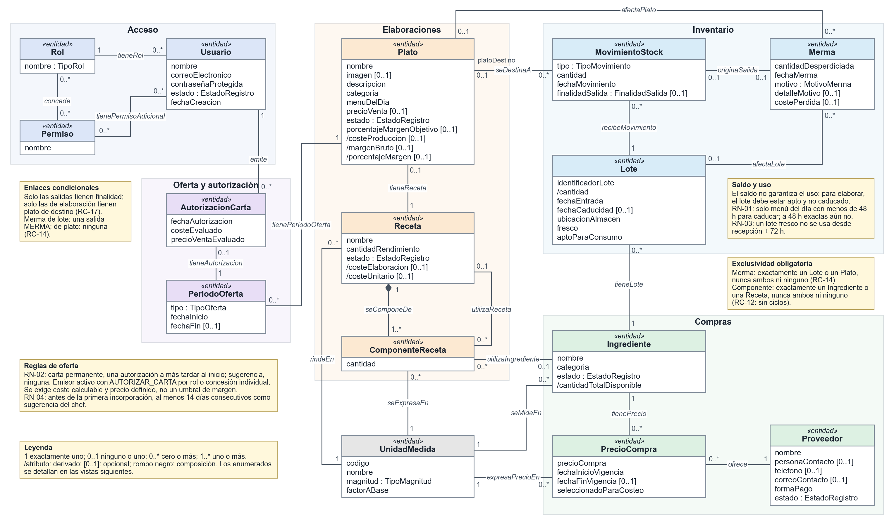

## 4.2. Usuarios, roles y permisos

Cada usuario tiene un rol. Para las operaciones generales, `fn_tiene_permiso` exige que el usuario esté activo y, salvo si es administrador, que tenga el permiso correspondiente por rol o por concesión individual (RC-10). Por ejemplo, Luis, encargado, puede recibir el permiso de consultar la información económica sin cambiar de rol. Esta excepción no se aplica a RN-02: para autorizar una incorporación a carta se exige la concesión explícita de `AUTORIZAR_CARTA`, también al administrador.

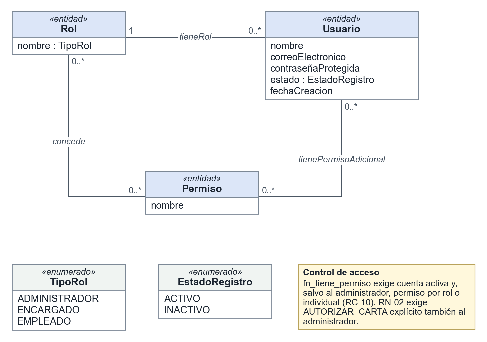

## 4.3. Proveedores, ingredientes y precios

PrecioCompra conserva el histórico de precios de cada proveedor e ingrediente. Se selecciona manualmente, como máximo, un precio por ingrediente para calcular costes, que debe estar vigente en el momento del cálculo (RI-04, RC-05). Si no hay uno válido seleccionado, el coste queda desconocido (RC-11).

UnidadMedida define las unidades admitidas, su magnitud y su factor de conversión a la unidad base de esa magnitud, lo que permite combinar, por ejemplo, gramos en una receta con un precio por kilogramo, y rechazar la conversión entre kilogramos y litros (RC-15).

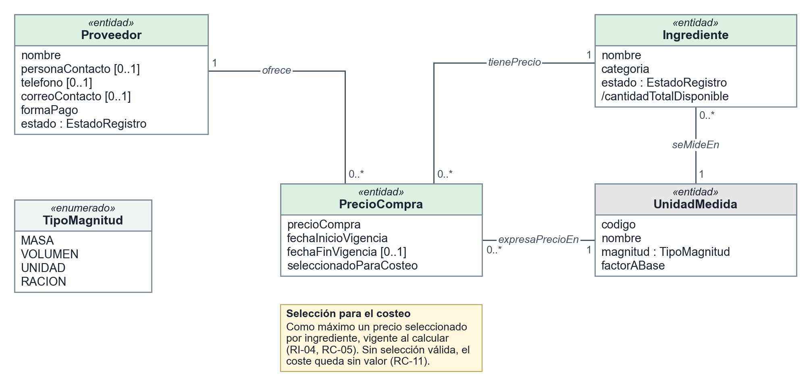

## 4.4. Platos y recetas

Cada plato tiene exactamente una receta. Una receta actúa como subreceta cuando otra la utiliza como componente, esté o no asociada a un plato (RI-06). Cada componente utiliza un ingrediente o una receta, con su cantidad y unidad. El rendimiento indica cuánto produce una receta y, si está asociada a un plato, se expresa en raciones (RI-06, RC-15). El rendimiento permite calcular el coste de la cantidad utilizada (RC-05). Las dependencias no pueden formar ciclos (RC-12).

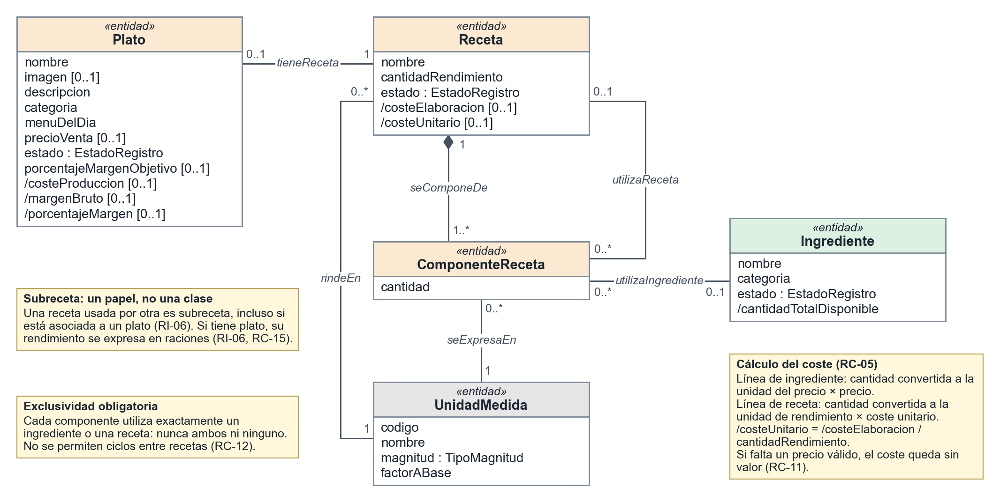

## 4.5. Lotes, movimientos y mermas

Los movimientos de entrada, salida y ajuste determinan el saldo de cada lote. Se admiten movimientos con fecha pasada si no dejan el saldo negativo en el momento afectado ni en ningún momento posterior (RC-13, RF-09). La cantidad total disponible de un ingrediente suma los saldos de sus lotes; no mide cuánto puede usarse para un plato concreto. Para elaborar, el lote debe estar apto y no caducado en la fecha del movimiento. Con menos de 48 horas para caducar, solo puede destinarse al menú del día; a las 48 horas exactas aún no se aplica esa restricción. Si es fresco, no se puede usar desde las 72 horas de la recepción, inclusive (RN-01, RN-03).

Cada salida tiene exactamente una finalidad (elaboración, merma u otra); las entradas y los ajustes no tienen ninguna. El movimiento tiene exactamente un plato de destino si es una salida de elaboración y ninguno en los demás casos (RC-17). Una merma de lote origina exactamente una salida con finalidad MERMA, del mismo lote, cantidad y fecha; una merma de plato no origina ningún movimiento. El coste de la merma puede quedar sin informar (RC-14).

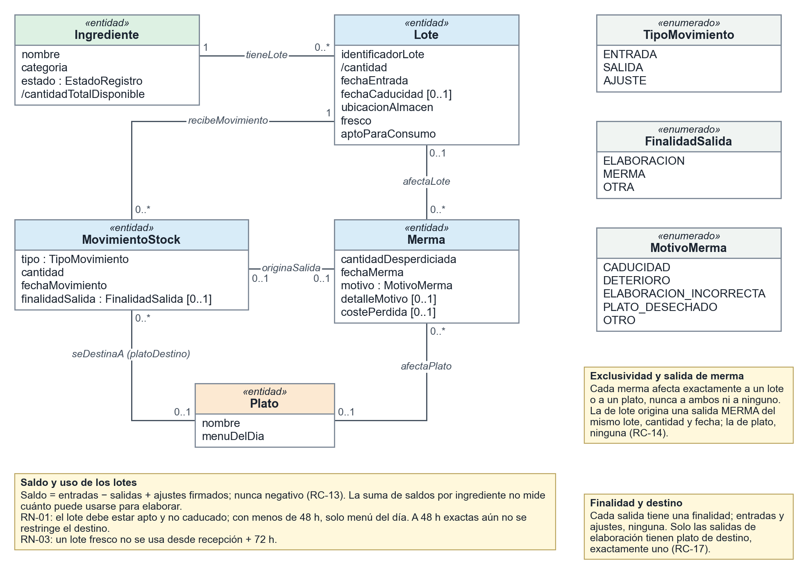

## 4.6. Oferta de platos y autorizaciones

Los periodos registran la oferta como sugerencia del chef o como carta permanente, y no pueden solaparse en un mismo plato (RC-16). Cada periodo de carta permanente tiene exactamente una autorización, registrada a más tardar al inicio del periodo; una sugerencia del chef no tiene ninguna. El emisor debe ser un usuario activo con `AUTORIZAR_CARTA`, concedido por su rol o individualmente. Se exige coste calculable y precio de venta definido, pero no un umbral de margen. La autorización conserva el emisor, la fecha y los importes evaluados (RN-02). Solo para la primera incorporación se exige además una sugerencia del chef cerrada, de al menos 14 días consecutivos y finalizada a más tardar al inicio del periodo de carta (RN-04).

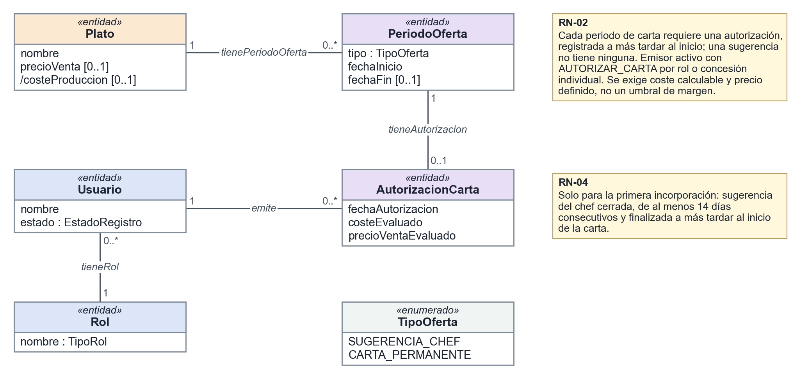

## 4.7. Escenarios de prueba

Los escenarios muestran objetos concretos del modelo. Las cabeceras subrayadas identifican objetos y sus atributos contienen valores de ejemplo. La expresión «unidad → kg» abrevia el enlace con el objeto UnidadMedida correspondiente. Los importes están en euros y las fechas son locales del restaurante. Los elementos rojos discontinuos representan intentos rechazados, no datos almacenados.

| Escenario | Objetivo | Reglas principales | Resultado esperado |
|---|---|---|---|
| 1. Precio seleccionado | Elegir un precio entre dos proveedores | RI-04, RC-03, RC-04, RC-05, RC-11 | Válido; referencia de 1,20 €/kg |
| 2. Coste con subreceta | Aplicar cantidades y rendimiento al escandallo | RI-06, RC-01, RC-02, RC-05, RC-07, RC-11, RC-12, RC-15 | Válido; coste del plato de 0,60 € |
| 3. Merma de lote | Registrar una pérdida y descontar el stock una sola vez | RC-09, RC-13, RC-14, RC-17 | Válido; saldo de 8 kg y pérdida de 4 € |
| 4. Límite de frescura | Rechazar una elaboración al cumplir 72 horas | RI-07, RN-03 | Rechazado; saldo sin cambios |
| 5. Incorporación a carta | Comprobar la prueba previa y el permiso explícito | RC-09, RC-10, RN-02, RN-04 | Administradora sin permiso: denegado; encargado con permiso: incorporación autorizada |
| 6. Límite de caducidad | Contrastar las 48 horas exactas con el instante siguiente | RN-01, RC-13, RC-17 | A 48 h se admite el plato ordinario; con menos de 48 h se rechaza el ordinario y se admite el menú del día |

Los seis escenarios ilustran reglas que también comprueba `sql/07_pruebas.sql`. La correspondencia es de reglas y resultados esperados, no de identidad de datos ni de reproducción literal de los diagramas.

### 4.7.1. Precio de referencia de un ingrediente

El 29 de octubre de 2026, la harina tiene dos precios vigentes: 1,20 €/kg de Distribuciones Norte y 1,40 €/kg de Suministros Sur. Solo el primero está seleccionado para calcular costes. Por tanto, utilizar 0,5 kg de harina cuesta 0,60 €; el precio del otro proveedor se conserva para consulta. La selección es explícita: que coincida con el más barato es circunstancial.

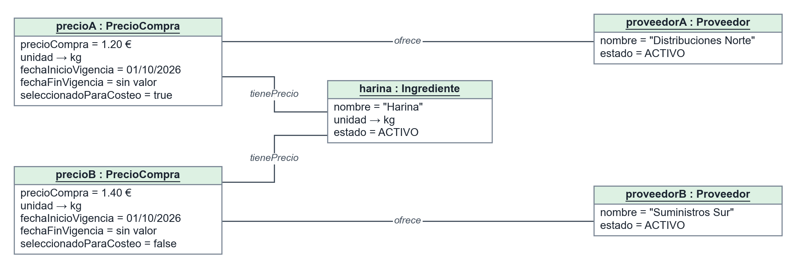

**Resultado: válido.** Los importes son positivos (RC-03), no hay vigencias solapadas para un mismo par proveedor-ingrediente (RC-04) y hay un único precio seleccionado (RI-04, RC-05).

### 4.7.2. Coste de un plato con una subreceta

Una elaboración de la receta de la salsa utiliza 2 kg de tomate a 3 €/kg y produce 1,5 kg. Su coste de elaboración es 6 € y su coste unitario, 4 €/kg. La receta de la degustación rinde una ración y utiliza 0,15 kg de salsa, que cuestan 0,60 €. Al venderse por 3 €, deja un margen bruto de 2,40 €, equivalente al 80 % del precio de venta. La receta de la salsa actúa aquí como subreceta: es una Receta más, utilizada como componente de otra.

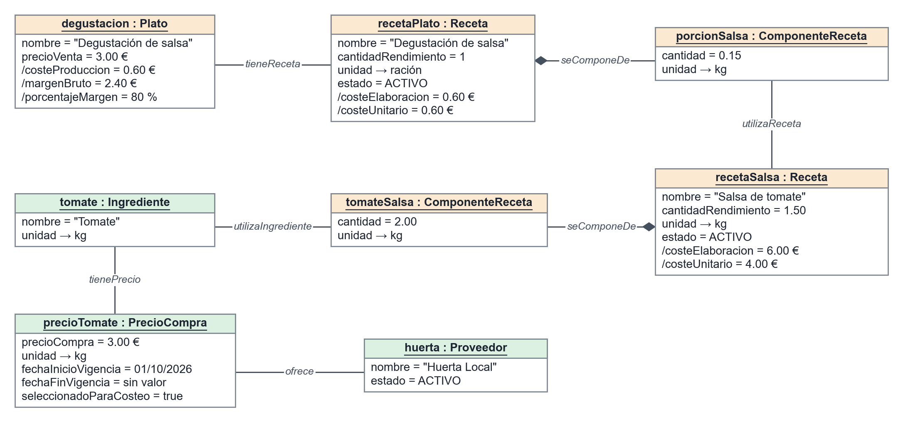

**Resultado: válido.** Las cantidades y el rendimiento son positivos (RC-01), no hay líneas repetidas (RC-02), la cadena termina en un ingrediente (RC-12) y todas las dependencias tienen un precio válido (RC-11). Este escenario comprueba el escandallo; no registra una elaboración real ni movimientos de almacén.

### 4.7.3. Merma y saldo del lote

El lote ARR-001 recibe 10 kg de arroz el 28 de octubre de 2026. Al día siguiente se derraman 2 kg. La merma genera una única salida y deja un saldo de 8 kg. La valoración aplicable es de 2 €/kg, de modo que se registra una pérdida de 4 €, que no se recalcula por cambios futuros de precios.

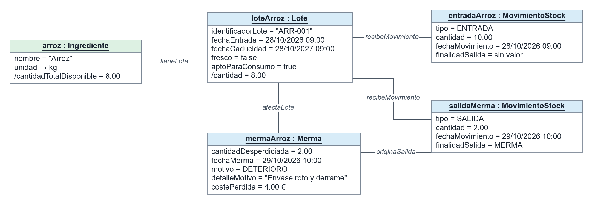

**Resultado: válido.** Se descuenta una sola salida (RC-14). Restar además la cantidad de la merma produciría un saldo incorrecto de 6 kg.

### 4.7.4. Rechazo de un lote fresco

Un lote fresco de lechuga entra el 26 de octubre de 2026 a las 10:00. El día 29 a esa misma hora se intenta utilizar 0,20 kg para una ensalada. Aunque sigue apto, no ha caducado y el plato pertenece al menú del día, la operación se rechaza porque han transcurrido 72 horas. No se registra la salida y el saldo permanece en 3 kg. Los elementos rojos discontinuos representan el intento rechazado, no información almacenada.

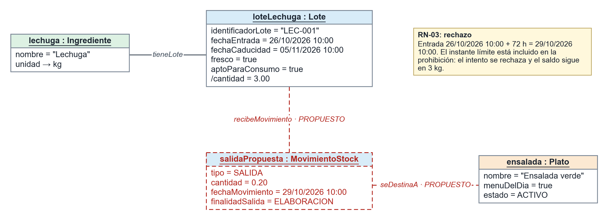

**Resultado: rechazado por RN-03.** El rechazo no crea automáticamente una merma; cualquier pérdida posterior debe registrarse por separado.

### 4.7.5. Incorporación autorizada a la carta

La lasaña completa 14 días de prueba como sugerencia del chef, del 1 al 15 de octubre de 2026 a las 12:00. Su coste calculado es 4 € y su precio de venta, 10 €. El día 15 a las 10:00, Ana, administradora activa sin `AUTORIZAR_CARTA` por ninguna vía, intenta autorizar la incorporación. El intento se deniega sin registrar un periodo de carta ni una autorización. A las 11:00, Luis, encargado activo con `AUTORIZAR_CARTA` concedido individualmente, autoriza la incorporación a la carta, cuyo periodo comienza a las 12:00.

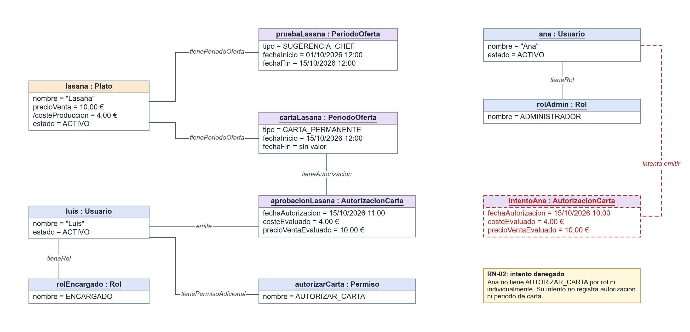

**Resultado: un intento denegado y una incorporación válida.** El cargo no sustituye el permiso (RN-02). Al comenzar el periodo de carta ya han transcurrido los 14 días consecutivos de prueba (RN-04). Se conservan el coste y el precio evaluados, sin imponer un umbral de margen (RN-02, RC-09).

### 4.7.6. Límite de 48 horas antes de caducar

Un lote apto y no clasificado como fresco recibe 10 kg el 9 de noviembre de 2026 a las 08:00 y caduca el 12 de noviembre a las 08:00. Se prueban por separado tres salidas de elaboración de 1 kg, todas desde el mismo saldo inicial. El día 10 a las 08:00, cuando faltan exactamente 48 horas, se admite la salida para un plato ordinario. Un microsegundo después (08:00:00.000001), se rechaza la salida para ese plato y se admite la salida para un plato del menú del día.

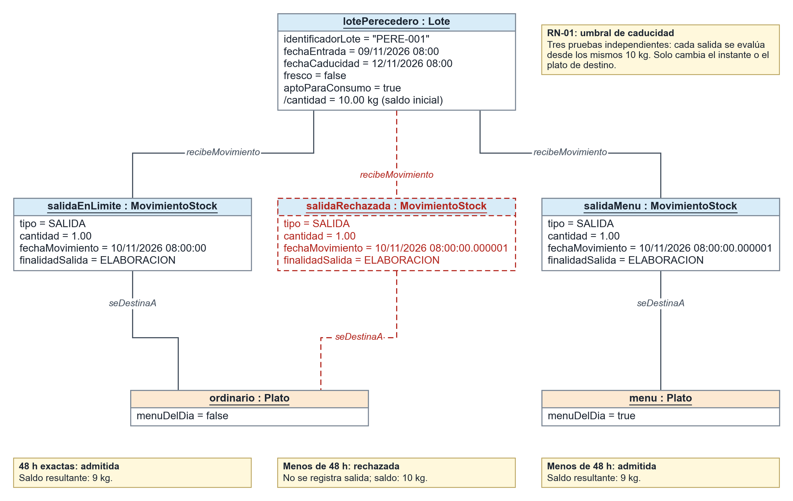

**Resultado: dos salidas admisibles y una rechazada (RN-01).** Cada caso admitido dejaría 9 kg; el rechazo no registra salida y mantiene los 10 kg. Como en `sql/07_pruebas.sql`, los casos no acumulan sus movimientos.
