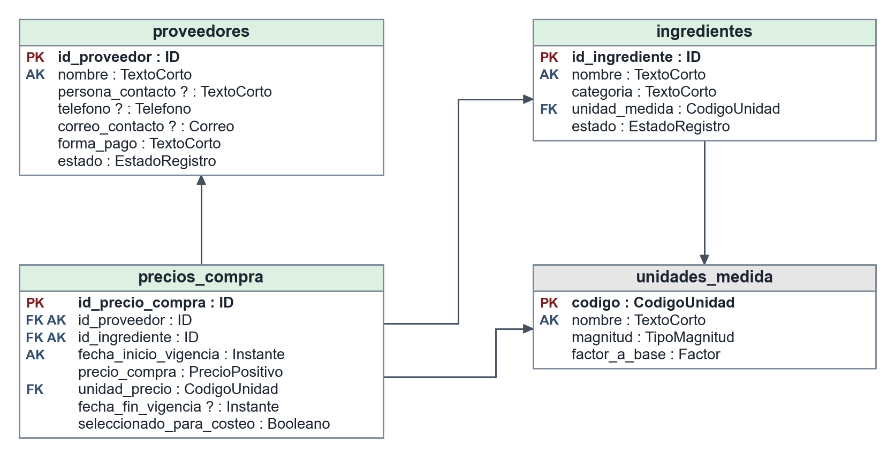
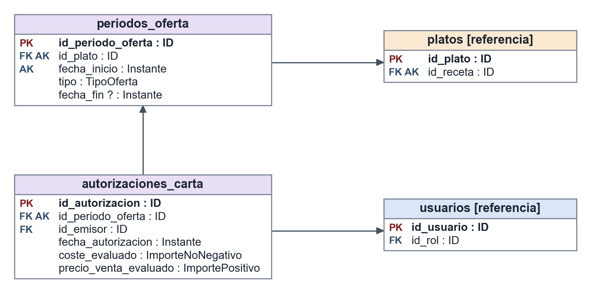

# 5. Modelo relacional en 3FN

Este capítulo transforma el modelo conceptual (§4) y justifica la 3FN de las relaciones. Los identificadores RN, RC, RI y RNF remiten al catálogo de requisitos.

**Notación.** `relacion(pk, atributo, atributo?, #fk)`: la PK es el primer atributo (ambos en las relaciones N:M); `#` indica FK y `?`, que admite nulos. AK indica una clave alternativa global; una unicidad por rama identifica filas solo dentro de esa rama. Los nombres coinciden con el SQL.

## 5.1. Relaciones obtenidas

### 5.1.1. Proceso de transformación

Cada entidad se convierte en una relación con PK subrogada (`id_*`), salvo `unidades_medida`, con código natural. Los atributos simples pasan a columnas, los enumerados a dominios cerrados y los derivados no se almacenan (§5.3.3).

En 1:N, la FK va en el extremo N y admite nulos si el vínculo es opcional. En 1:1, la FK va en la dependiente con `UNIQUE`: es obligatoria en `platos` y `autorizaciones_carta`; en `mermas` se exige por `CHECK` solo para la rama de lote. La FK no exige que exista una fila dependiente. En N:M, las dos FK forman la PK de una relación propia. La recursión usa una segunda FK a `recetas`; en las asociaciones exclusivas, un `CHECK` exige exactamente una FK informada.

**Tabla 5.1. Correspondencia de entidades del MC con relaciones del MR.**

| Grupo | Entidad → relación |
|---|---|
| Acceso | Rol → `roles`; Permiso → `permisos`; Usuario → `usuarios` (`contraseñaProtegida` → `contrasena_protegida`) |
| Compras | Proveedor → `proveedores`; UnidadMedida → `unidades_medida`; Ingrediente → `ingredientes`; PrecioCompra → `precios_compra` |
| Recetas | Plato → `platos`; Receta → `recetas`; ComponenteReceta → `componentes_receta` |
| Inventario | Lote → `lotes`; MovimientoStock → `movimientos_stock`; Merma → `mermas` |
| Oferta | PeriodoOferta → `periodos_oferta`; AutorizacionCarta → `autorizaciones_carta` |

**Tabla 5.2. Correspondencia de asociaciones del MC con elementos del MR.**

La columna de destino indica la relación referenciada; la FK apunta a su PK (§5.1.2).

| Asociación (MC) | Multiplicidad | FK → destino |
|---|---|---|
| tieneRol | Rol 1 — 0..\* Usuario | `usuarios.id_rol` → `roles` |
| concede | Rol 0..\* — 0..\* Permiso | `roles_permisos`: `id_rol` → `roles`; `id_permiso` → `permisos` |
| tienePermisoAdicional | Usuario 0..\* — 0..\* Permiso | `permisos_adicionales_usuario`: `id_usuario` → `usuarios`; `id_permiso` → `permisos` |
| emite | Usuario 1 — 0..\* AutorizacionCarta | `autorizaciones_carta.id_emisor` → `usuarios` |
| ofrece | Proveedor 1 — 0..\* PrecioCompra | `precios_compra.id_proveedor` → `proveedores` |
| tienePrecio | Ingrediente 1 — 0..\* PrecioCompra | `precios_compra.id_ingrediente` → `ingredientes` |
| seMideEn | UnidadMedida 1 — 0..\* Ingrediente | `ingredientes.unidad_medida` → `unidades_medida` |
| expresaPrecioEn | UnidadMedida 1 — 0..\* PrecioCompra | `precios_compra.unidad_precio` → `unidades_medida` |
| rindeEn | UnidadMedida 1 — 0..\* Receta | `recetas.unidad_rendimiento` → `unidades_medida` |
| seExpresaEn | UnidadMedida 1 — 0..\* ComponenteReceta | `componentes_receta.unidad_medida` → `unidades_medida` |
| tieneReceta | Plato 0..1 — 1 Receta | `platos.id_receta` → `recetas` |
| seComponeDe | Receta 1 — 1..\* ComponenteReceta | `componentes_receta.id_receta` → `recetas` |
| utilizaIngrediente | ComponenteReceta 0..\* — 0..1 Ingrediente | `componentes_receta.id_ingrediente` → `ingredientes` |
| utilizaReceta | ComponenteReceta 0..\* — 0..1 Receta | `componentes_receta.id_receta_componente` → `recetas` |
| tieneLote | Ingrediente 1 — 0..\* Lote | `lotes.id_ingrediente` → `ingredientes` |
| recibeMovimiento | Lote 1 — 0..\* MovimientoStock | `movimientos_stock.id_lote` → `lotes` |
| seDestinaA | MovimientoStock 0..\* — 0..1 Plato | `movimientos_stock.id_plato_destino` → `platos` |
| afectaLote | Merma 0..\* — 0..1 Lote | `mermas.id_lote` → `lotes` |
| afectaPlato | Merma 0..\* — 0..1 Plato | `mermas.id_plato` → `platos` |
| originaSalida | Merma 0..1 — 0..1 MovimientoStock | `mermas.id_movimiento` → `movimientos_stock` |
| tienePeriodoOferta | Plato 1 — 0..\* PeriodoOferta | `periodos_oferta.id_plato` → `platos` |
| tieneAutorizacion | PeriodoOferta 1 — 0..1 AutorizacionCarta | `autorizaciones_carta.id_periodo_oferta` → `periodos_oferta` |

### 5.1.2. Esquema relacional resultante

El modelo consta de 17 relaciones: 15 procedentes de entidades y 2 de asociaciones N:M.

**Acceso y permisos**

- `roles(id_rol, nombre)`; AK: `nombre`.
- `permisos(id_permiso, nombre)`; AK: `nombre`.
- `usuarios(id_usuario, nombre, correo_electronico, contrasena_protegida, estado, fecha_creacion, #id_rol)`; AK: `correo_electronico`.
- `roles_permisos(#id_rol, #id_permiso)`.
- `permisos_adicionales_usuario(#id_usuario, #id_permiso)`.

**Compras y precios**

- `unidades_medida(codigo, nombre, magnitud, factor_a_base)`; AK: `nombre`.
- `proveedores(id_proveedor, nombre, persona_contacto?, telefono?, correo_contacto?, forma_pago, estado)`; AK: `nombre`.
- `ingredientes(id_ingrediente, nombre, categoria, #unidad_medida, estado)`; AK: `nombre`.
- `precios_compra(id_precio_compra, #id_proveedor, #id_ingrediente, precio_compra, #unidad_precio, fecha_inicio_vigencia, fecha_fin_vigencia?, seleccionado_para_costeo)`; AK: `(id_proveedor, id_ingrediente, fecha_inicio_vigencia)`.

**Platos y recetas**

- `recetas(id_receta, nombre, cantidad_rendimiento, #unidad_rendimiento, estado)`; AK: `nombre`.
- `platos(id_plato, #id_receta, nombre, imagen?, descripcion, categoria, menu_del_dia, precio_venta?, estado, porcentaje_margen_objetivo?)`; AK: `id_receta`; AK: `nombre`.
- `componentes_receta(id_componente, #id_receta, cantidad, #unidad_medida, #id_ingrediente?, #id_receta_componente?)`; unicidades condicionales: `(id_receta, id_ingrediente)` para líneas de ingrediente y `(id_receta, id_receta_componente)` para líneas de subreceta.

**Lotes, stock y mermas**

- `lotes(id_lote, identificador_lote, #id_ingrediente, fecha_entrada, fecha_caducidad?, ubicacion_almacen, fresco, apto_para_consumo)`; AK: `identificador_lote`.
- `movimientos_stock(id_movimiento, #id_lote, tipo, cantidad, fecha_movimiento, finalidad_salida?, #id_plato_destino?)`.
- `mermas(id_merma, cantidad_desperdiciada, fecha_merma, motivo, detalle_motivo?, coste_perdida?, #id_lote?, #id_plato?, #id_movimiento?)`; unicidad condicional: `id_movimiento` para mermas de lote.

**Oferta y autorización**

- `periodos_oferta(id_periodo_oferta, #id_plato, tipo, fecha_inicio, fecha_fin?)`; AK: `(id_plato, fecha_inicio)`.
- `autorizaciones_carta(id_autorizacion, #id_periodo_oferta, #id_emisor, fecha_autorizacion, coste_evaluado, precio_venta_evaluado)`; AK: `id_periodo_oferta`.

Las vistas siguientes detallan los atributos y dominios de cada grupo. Una tabla marcada como [referencia] solo se muestra para situar una clave ajena.

### 5.1.3. Dominios

**Tabla 5.3. Dominios del modelo relacional.**

| Dominio | Definición |
|---|---|
| ID, Instante, Booleano | Entero positivo generado; fecha y hora local del restaurante; verdadero o falso, respectivamente. |
| Textos (máx. caracteres) | CodigoUnidad: 10; Telefono: 20; TextoCorto: 100; Correo: 150 (con arroba); Ruta: 255; Texto: 500. |
| Hash | Mínimo 60 caracteres (RNF-02; véase §5.1.5). |
| CantidadPositiva, PrecioPositivo, CantidadFirmada | Cuatro decimales: los dos primeros > 0; el último ≠ 0. |
| ImportePositivo, ImporteNoNegativo | Dos decimales: > 0 y ≥ 0, respectivamente. |
| Porcentaje | Decimal en el intervalo [0, 100). |
| Factor | Decimal mayor que cero, con seis decimales. |
| TipoRol | ADMINISTRADOR, ENCARGADO, EMPLEADO. |
| EstadoRegistro | ACTIVO, INACTIVO. |
| TipoMagnitud | MASA, VOLUMEN, UNIDAD, RACION. |
| TipoMovimiento | ENTRADA, SALIDA, AJUSTE. |
| FinalidadSalida | ELABORACION, MERMA, OTRA. |
| MotivoMerma | CADUCIDAD, DETERIORO, ELABORACION_INCORRECTA, PLATO_DESECHADO, OTRO. |
| TipoOferta | SUGERENCIA_CHEF, CARTA_PERMANENTE. |

### 5.1.4. Integridad referencial

Por RC-09, las entidades maestras se desactivan mediante `estado` y las FK usan `ON DELETE RESTRICT`, salvo `CASCADE` en las dos FK de cada tabla de concesiones (no son hechos históricos) y en `componentes_receta.id_receta` (composición). Todas usan `ON UPDATE RESTRICT`, incluidas las cuatro a `unidades_medida.codigo`.

Una FK protege la referencia, no vuelve inmutable la fila: los triggers protegen el histórico y los atributos no clave de las unidades en uso (magnitud y factor), según §5.1.5.

### 5.1.5. Catálogo de restricciones

**Esquema (`01_tablas.sql`).** Además de las claves de §5.1.2 y la política de §5.1.4:

- `CHECK` de cantidad, rendimiento y precio positivos (RC-01, RC-03, RC-15), margen objetivo opcional en su dominio (RC-08), fin posterior al inicio (RC-04, RC-16) e importes de autorización en sus dominios (RN-02).
- `CHECK` de exclusividad y dos `UNIQUE` para componentes, uno por cada referencia posible (RC-02). En mermas, el `CHECK` exige movimiento para lote y lo prohíbe para plato; `UNIQUE(id_movimiento)` impide enlazar la misma salida a dos mermas (RC-14). Se prohíbe la autorreferencia directa de una receta (RC-12) y se comprueba la coherencia entre tipo de movimiento, cantidad, finalidad y destino (RC-17).
- A lo sumo un precio seleccionado por ingrediente (RI-04, RC-05): en MariaDB, un índice único sobre una columna virtual que devuelve `id_ingrediente` si está seleccionado y `NULL` si no. La columna no se almacena ni forma parte del modelo lógico.

**Triggers (`05_triggers.sql`).**

- Rechazan solapes al insertar o actualizar precios y al insertar periodos; los periodos no pueden cambiar de inicio ni prolongarse (RC-04, RC-16). Bloquean `UPDATE` y `DELETE` de movimientos, mermas y autorizaciones y `DELETE` de periodos y precios. Los precios sí admiten cambios sujetos a validaciones de vigencia y unidad (RC-09).
- Detectan ciclos al insertar o actualizar componentes e impiden quitar o trasladar el último componente de una receta conservada. Validan magnitudes y rendimiento en raciones para platos y limitan cambios de unidades y rendimientos en uso (RC-12, RI-06, RC-15).
- Validan fecha de recepción, aptitud, caducidad y destino al menú del día según las reglas de elaboración; para lotes frescos rechazan salidas de elaboración desde las 72 horas de la recepción. Protegen ingrediente y fecha de entrada en lotes con movimientos (RC-17, RN-01, RI-07, RN-03). `trg_merma_bi_coherencia` exige que la salida enlazada sea por merma y coincida en lote, cantidad y fecha (RC-14).
- Para autorizar carta, validan periodo de carta, fecha no futura ni posterior al inicio y emisor activo con `AUTORIZAR_CARTA` explícito por rol o usuario (`fn_puede_autorizar_carta`, sin excepción para administradores). Recalculan los importes con `sp_interno_valorar_carta`, que exige coste calculable y precio definido, sin umbral de margen. La primera incorporación exige una sugerencia previa cerrada de al menos 14 días consecutivos y el periodo de prueba queda protegido (RN-02, RN-04).

**Rutinas (`04_funciones_procedimientos.sql`) y acceso.**

- `sp_registrar_receta` crea receta y al menos un componente; `sp_incorporar_carta` crea periodo y autorización y comparte la valoración con el trigger. Cada alta es transaccional (RN-02 para carta).
- `sp_registrar_movimiento` valida fecha y primera entrada y no admite salidas por merma. `sp_registrar_merma` exige entrada previa para lote y registra salida y merma juntas; para plato no genera salida. Ambos flujos, cuando generan un movimiento, bloquean el lote y revierten la operación si `fn_lote_tiene_saldo_negativo` detecta un saldo negativo al recorrer el historial por fecha e ID. Las diferencias de inventario se registran como ajustes, no reescribiendo movimientos (RC-09, RC-13, RC-14, RC-17).
- Para costear, el precio seleccionado debe estar vigente; sin precio válido, el coste queda nulo (§5.3.3; RC-05 a RC-07, RC-11). `fn_convertir` no convierte entre magnitudes (RC-15).
- `fn_tiene_permiso` exige usuario activo: para administradores no comprueba concesión ni existencia del permiso; para el resto exige concesión por rol o usuario (RC-10). MariaDB autentica la conexión; las cuentas operativas solo tienen los privilegios asignados sobre vistas y procedimientos públicos (`08_cuentas_privilegios.sql`), sin acceso directo a tablas. `sp_demo_*` identifica al usuario de aplicación por la cuenta conectada, no por un ID aportado (RNF-01). El `CHECK` de longitud del hash de aplicación no acredita el algoritmo: el poblado usa scrypt con sal individual, generado fuera de SQL y ajeno a las credenciales MariaDB (RNF-02).

**Diagnósticos (`03_consultas.sql`).** Detectan incidencias; no bloquean escrituras ni corrigen datos (RNF-06).

| Consulta | Qué detecta |
|---|---|
| C-16 | Ingredientes que afectan a platos sin precio seleccionado y vigente; no cubre todas las causas de coste nulo (RI-04, RC-05, RC-11). |
| C-23 | Recetas sin componentes y cartas sin autorización. |
| C-24 / C-25 | Solapes de precios y periodos (RC-04, RC-16) / ciclos de recetas (RC-12). |
| C-26 | Saldos históricos negativos, mermas de lote discordantes con su salida y salidas por merma sin merma asociada (RC-13, RC-14). |
| C-27 | Elaboraciones con lotes caducados o frescos fuera de plazo (RN-01, RN-03; no comprueba aptitud ni destino al menú del día); autorizaciones tardías respecto al inicio o de periodos que no son de carta (RN-02); primeras incorporaciones sin prueba válida (RN-04). |

**Límites del DML directo.** Quien puede escribir en tablas sigue sujeto al DDL y a los triggers, pero puede crear una receta vacía (sin coste calculable) o una carta sin autorización (C-23). Si inserta la autorización, el trigger la valida y sustituye los importes aportados. También puede registrar saldos negativos o dejar salidas por merma sin vínculo (C-26), u omitir las comprobaciones operativas de primera entrada, que C-26 no sustituye.

## 5.2. Estrategia de transformación de jerarquías

No hay jerarquías de generalización. Subreceta es un papel de Receta (puede ser también la de un plato); los movimientos comparten estructura y sus opcionales dependen de RC-17; los roles se distinguen por sus concesiones, no por atributos propios.

Las mermas de lote y de plato comparten una relación: un `CHECK` exige uno solo de los dos destinos y obliga a enlazar una salida únicamente en la merma de lote. `componentes_receta` aplica la misma estrategia de referencias excluyentes para ingrediente o subreceta.

## 5.3. Justificación de la 3FN

### 5.3.1. Criterio

**1FN:** los valores son atómicos, incluido el contacto del proveedor, separado en persona, teléfono y correo (RI-02), y el motivo de merma, con categoría cerrada y detalle opcional (RI-09). **2FN:** ningún atributo no primo depende de una parte propia de una clave candidata. **3FN:** en toda dependencia funcional (DF) no trivial `X → A`, `X` es superclave o `A` es primo.

Un `CHECK` de presencia no determina el valor concreto de la columna. En MariaDB, `UNIQUE` admite varias filas si alguna columna de la clave es `NULL`: las unicidades de componentes, movimiento de merma y precio seleccionado identifican filas solo en su rama, no son AK globales.

### 5.3.2. Análisis por relación

Las claves candidatas son las PK y AK de §5.1.2: cada una determina el resto de atributos de su relación. Las claves simples no admiten dependencias parciales. En `roles_permisos` y `permisos_adicionales_usuario` no hay DF no triviales: la PK compuesta contiene todos los atributos y ninguno de los dos extremos determina al otro. Las únicas AK globales compuestas son las de precios y periodos de oferta.

| Relaciones | Dependencias descartadas |
|---|---|
| `roles`, `permisos`, `usuarios` | En las dos primeras todos los atributos son claves simples. En `usuarios` el nombre puede repetirse y el rol no determina otros campos; sus concesiones están en `roles_permisos`. |
| `unidades_medida`, `proveedores`, `ingredientes` | La magnitud no fija el factor; el contacto no fija teléfono ni correo entre proveedores; la categoría no fija la unidad del ingrediente. |
| `precios_compra` | Ninguna parte de la AK fija los atributos no primos: hay varias vigencias por proveedor e ingrediente, y una misma fecha de inicio puede corresponder a distintas ofertas. La unidad de precio puede variar entre ofertas. No se deducen precio, unidad, fin ni selección de otro atributo no clave. |
| `recetas`, `platos`, `componentes_receta` | Cantidad y unidad de rendimiento y estado no se determinan entre sí. En `platos`, `id_receta` es clave, y la categoría no fija precio ni pertenencia al menú. Ni la receta ni el ingrediente o la subreceta por separado fijan cantidad o unidad de una línea. |
| `lotes`, `movimientos_stock`, `mermas` | El ingrediente no fija frescura ni caducidad del lote; el tipo de movimiento no fija la finalidad ni esta fija el plato. El detalle de merma no determina el motivo y `id_movimiento` identifica solo la rama de lote; la redundancia entre tablas se justifica en §5.3.4. |
| `periodos_oferta`, `autorizaciones_carta` | Ni el plato ni el inicio de la AK compuesta determinan por separado el tipo o fin del periodo. En la autorización, el periodo es clave; el emisor no fija fecha ni importes. |

Con estas DF, las 17 relaciones cumplen 1FN, 2FN y 3FN.

### 5.3.3. Atributos derivados e importes históricos

Saldo, coste corriente y margen se calculan a demanda. El coste usa la composición y la selección de precios actuales, con vigencia en la fecha de referencia; no reconstruye el escandallo histórico (véase el [capítulo 6](06_modelo_tecnologico.md)).

**Tabla 5.4. Cálculo de los atributos derivados.**

| Atributo (MC) | Cálculo | Rutina | Consulta |
|---|---|---|---|
| Lote `/cantidad` | Entradas − salidas + ajustes con signo | `fn_stock_lote` | C-05 (saldo positivo), C-17 (por movimiento) |
| Ingrediente `/cantidadTotalDisponible` | Suma de saldos de lotes; no implica aptitud para elaborar | — | C-06 (ingredientes activos) |
| Receta `/costeElaboracion` y `/costeUnitario` | Suma de líneas, expandiendo subrecetas y ajustando por su rendimiento; el coste unitario divide el total por `cantidad_rendimiento` | `fn_coste_receta` (solo unitario) | C-15 |
| Plato `/costeProduccion` | Coste unitario de su receta (por ración) | `fn_coste_plato`, `sp_consultar_escandallo` | C-14 (detalle por ingrediente y ración), C-15 |
| Plato `/margenBruto` y `/porcentajeMargen` | `precio_venta` − `/costeProduccion`; 100 × `/margenBruto` / `precio_venta` | `fn_margen_plato` (bruto), `sp_consultar_escandallo` | C-15 |

**Importes históricos.** `mermas.coste_perdida` guarda el total aportado para lote o plato, o `NULL` si se desconoce; la rutina no lo calcula ni usa el precio seleccionado para rellenarlo. `autorizaciones_carta.coste_evaluado` y `precio_venta_evaluado` guardan los valores de la evaluación. Estos importes dependen de la clave del hecho histórico, no de precios ni composición actuales.

### 5.3.4. Redundancia controlada de las mermas

No hay desnormalización por rendimiento. La merma de lote repite lote, cantidad y fecha de su salida en `movimientos_stock`: es redundancia entre relaciones, no una infracción de 3FN dentro de ellas. El modelo conceptual y el escenario 3 dan a la merma cantidad y fecha propias; las mermas de plato no tienen salida y guardar esos datos también para lote permite consultar todas las pérdidas sin separar los casos.

La transacción de `sp_registrar_merma`, la validación al insertar la merma y la inmutabilidad de ambas filas controlan la redundancia (§5.1.5). C-26 detecta discrepancias y salidas huérfanas, pero no impide que el DML directo las origine.
