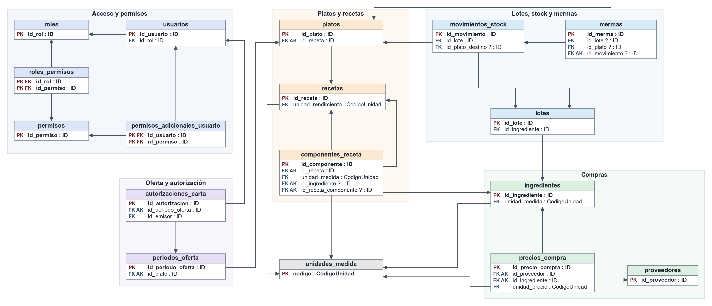
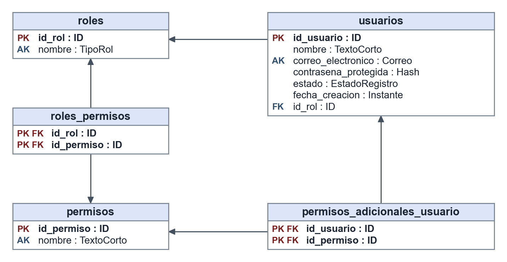
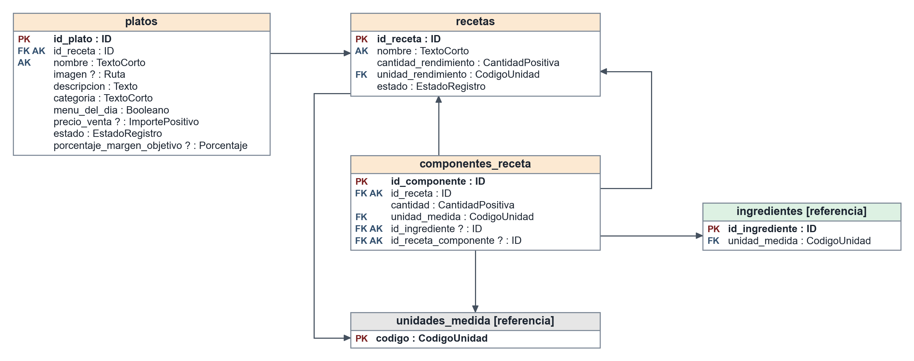
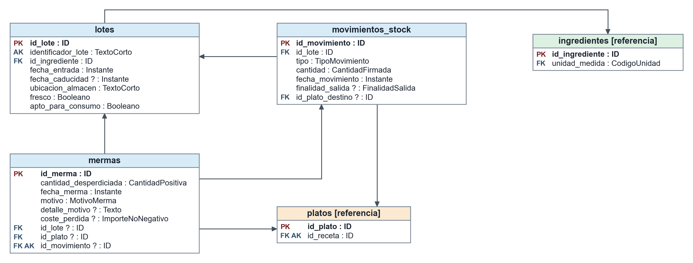

# 5. Modelo relacional en 3FN

Esta sección obtiene el modelo relacional a partir del modelo conceptual de la sección 4 y justifica que todas sus relaciones están en tercera forma normal. Las reglas se citan con los identificadores del catálogo de requisitos (RN, RC, y más).

**Notación.** `relacion(pk, atributo, atributo?, #fk)`: el primer atributo es la clave primaria, `#` indica clave ajena y `?` indica que el atributo admite nulos. En las dos relaciones procedentes de asociaciones N:M, la clave primaria está formada por todos sus atributos. AK designa una clave alternativa. Los nombres coinciden con los que se utilizan en el código SQL.

## 5.1. Relaciones obtenidas

### 5.1.1. Proceso de transformación

La transformación se aplica en siete pasos:

1. **Entidades.** Cada entidad da lugar a una relación con clave primaria subrogada (`id_*`), salvo `unidades_medida`, cuyo código es una clave natural breve y estable.
2. **Atributos.** Los atributos simples pasan a columnas. Los derivados no se almacenan (sección 5.3.3). Los enumerados pasan a dominios cerrados.
3. **Asociaciones 1:N.** La clave primaria del extremo 1 se añade como clave ajena en el extremo N. Si el mínimo es 0, la clave ajena admite nulos.
4. **Asociaciones 1:1.** La clave ajena se sitúa en la relación dependiente y se declara `UNIQUE`. Es `NOT NULL` si toda fila de esa relación debe apuntar a la otra (`platos`, `autorizaciones_carta`); si el vínculo es opcional, admite nulos (`mermas`), con un `CHECK` que lo exige para las mermas de lote. La FK no obliga por sí sola a que una fila referenciada tenga una fila dependiente.
5. **Asociaciones N:M.** Generan una relación propia cuya clave primaria es la combinación de ambas claves ajenas.
6. **Asociación recursiva.** `utilizaReceta` se transforma en una segunda clave ajena de `componentes_receta` hacia `recetas`.
7. **Asociaciones exclusivas.** Cada alternativa se transforma en una clave ajena que admite nulos, y una restricción CHECK exige que se informe exactamente una.

La Tabla 5.1 recoge la correspondencia de las entidades y la Tabla 5.2, la de las asociaciones.

**Tabla 5.1. Correspondencia de entidades del MC con relaciones del MR.**

| Entidad (MC) | Relación (MR) | Observaciones |
|---|---|---|
| Rol | `roles` | `nombre` es clave alternativa. |
| Permiso | `permisos` | `nombre` es clave alternativa. |
| Usuario | `usuarios` | `contraseñaProtegida` pasa a `contrasena_protegida`. |
| Proveedor | `proveedores` | Contacto en atributos atómicos (RI-02). |
| UnidadMedida | `unidades_medida` | Clave primaria natural `codigo`. |
| Ingrediente | `ingredientes` | `/cantidadTotalDisponible` no se almacena. |
| PrecioCompra | `precios_compra` | Histórico por vigencias. |
| Plato | `platos` | `/costeProduccion`, `/margenBruto` y `/porcentajeMargen` no se almacenan. |
| Receta | `recetas` | `/costeElaboracion` y `/costeUnitario` no se almacenan. |
| ComponenteReceta | `componentes_receta` | Componente exclusivo. |
| Lote | `lotes` | `/cantidad` no se almacena. |
| MovimientoStock | `movimientos_stock` | Origen del saldo de cada lote. |
| Merma | `mermas` | Elemento afectado exclusivo. |
| PeriodoOferta | `periodos_oferta` | |
| AutorizacionCarta | `autorizaciones_carta` | |

**Tabla 5.2. Correspondencia de asociaciones del MC con elementos del MR.**

| Asociación (MC) | Multiplicidad | Clave ajena → clave referenciada |
|---|---|---|
| tieneRol | Rol 1 — 0..\* Usuario | `usuarios.id_rol` → `roles.id_rol` |
| concede | Rol 0..\* — 0..\* Permiso | `roles_permisos.id_rol` → `roles.id_rol`; `roles_permisos.id_permiso` → `permisos.id_permiso` |
| tienePermisoAdicional | Usuario 0..\* — 0..\* Permiso | `permisos_adicionales_usuario.id_usuario` → `usuarios.id_usuario`; `permisos_adicionales_usuario.id_permiso` → `permisos.id_permiso` |
| emite | Usuario 1 — 0..\* AutorizacionCarta | `autorizaciones_carta.id_emisor` → `usuarios.id_usuario` |
| ofrece | Proveedor 1 — 0..\* PrecioCompra | `precios_compra.id_proveedor` → `proveedores.id_proveedor` |
| tienePrecio | Ingrediente 1 — 0..\* PrecioCompra | `precios_compra.id_ingrediente` → `ingredientes.id_ingrediente` |
| seMideEn | UnidadMedida 1 — 0..\* Ingrediente | `ingredientes.unidad_medida` → `unidades_medida.codigo` |
| expresaPrecioEn | UnidadMedida 1 — 0..\* PrecioCompra | `precios_compra.unidad_precio` → `unidades_medida.codigo` |
| rindeEn | UnidadMedida 1 — 0..\* Receta | `recetas.unidad_rendimiento` → `unidades_medida.codigo` |
| seExpresaEn | UnidadMedida 1 — 0..\* ComponenteReceta | `componentes_receta.unidad_medida` → `unidades_medida.codigo` |
| tieneReceta | Plato 0..1 — 1 Receta | `platos.id_receta` → `recetas.id_receta` (`NOT NULL`, `UNIQUE`) |
| seComponeDe | Receta 1 — 1..\* ComponenteReceta | `componentes_receta.id_receta` → `recetas.id_receta` |
| utilizaIngrediente | ComponenteReceta 0..\* — 0..1 Ingrediente | `componentes_receta.id_ingrediente` → `ingredientes.id_ingrediente` (admite nulos) |
| utilizaReceta | ComponenteReceta 0..\* — 0..1 Receta | `componentes_receta.id_receta_componente` → `recetas.id_receta` (admite nulos) |
| tieneLote | Ingrediente 1 — 0..\* Lote | `lotes.id_ingrediente` → `ingredientes.id_ingrediente` |
| recibeMovimiento | Lote 1 — 0..\* MovimientoStock | `movimientos_stock.id_lote` → `lotes.id_lote` |
| seDestinaA | MovimientoStock 0..\* — 0..1 Plato | `movimientos_stock.id_plato_destino` → `platos.id_plato` (admite nulos) |
| afectaLote | Merma 0..\* — 0..1 Lote | `mermas.id_lote` → `lotes.id_lote` (admite nulos) |
| afectaPlato | Merma 0..\* — 0..1 Plato | `mermas.id_plato` → `platos.id_plato` (admite nulos) |
| originaSalida | Merma 0..1 — 0..1 MovimientoStock | `mermas.id_movimiento` → `movimientos_stock.id_movimiento` (`UNIQUE`; obligatorio solo para mermas de lote) |
| tienePeriodoOferta | Plato 1 — 0..\* PeriodoOferta | `periodos_oferta.id_plato` → `platos.id_plato` |
| tieneAutorizacion | PeriodoOferta 1 — 0..1 AutorizacionCarta | `autorizaciones_carta.id_periodo_oferta` → `periodos_oferta.id_periodo_oferta` (`NOT NULL`, `UNIQUE`; RN-02 exige autorización en carta permanente) |

### 5.1.2. Esquema relacional resultante

El modelo consta de 17 relaciones: 15 procedentes de entidades y 2 de asociaciones N:M.

**Acceso y permisos**

- `roles(id_rol, nombre)`; AK: `nombre`.
- `permisos(id_permiso, nombre)`; AK: `nombre`.
- `usuarios(id_usuario, nombre, correo_electronico, contrasena_protegida, estado, fecha_creacion, #id_rol)`; AK: `correo_electronico`.
- `roles_permisos(#id_rol, #id_permiso)`.
- `permisos_adicionales_usuario(#id_usuario, #id_permiso)`.

**Compras y precios**

- `unidades_medida(codigo, nombre, magnitud, factor_a_base)`; AK: `nombre`.
- `proveedores(id_proveedor, nombre, persona_contacto?, telefono?, correo_contacto?, forma_pago, estado)`; AK: `nombre`.
- `ingredientes(id_ingrediente, nombre, categoria, #unidad_medida, estado)`; AK: `nombre`.
- `precios_compra(id_precio_compra, #id_proveedor, #id_ingrediente, precio_compra, #unidad_precio, fecha_inicio_vigencia, fecha_fin_vigencia?, seleccionado_para_costeo)`; AK: `(id_proveedor, id_ingrediente, fecha_inicio_vigencia)`.

**Platos y recetas**

- `recetas(id_receta, nombre, cantidad_rendimiento, #unidad_rendimiento, estado)`; AK: `nombre`.
- `platos(id_plato, #id_receta, nombre, imagen?, descripcion, categoria, menu_del_dia, precio_venta?, estado, porcentaje_margen_objetivo?)`; AK: `id_receta`; AK: `nombre`.
- `componentes_receta(id_componente, #id_receta, cantidad, #unidad_medida, #id_ingrediente?, #id_receta_componente?)`; unicidades condicionales: `(id_receta, id_ingrediente)` para líneas de ingrediente y `(id_receta, id_receta_componente)` para líneas de subreceta.

**Lotes, stock y mermas**

- `lotes(id_lote, identificador_lote, #id_ingrediente, fecha_entrada, fecha_caducidad?, ubicacion_almacen, fresco, apto_para_consumo)`; AK: `identificador_lote`.
- `movimientos_stock(id_movimiento, #id_lote, tipo, cantidad, fecha_movimiento, finalidad_salida?, #id_plato_destino?)`.
- `mermas(id_merma, cantidad_desperdiciada, fecha_merma, motivo, detalle_motivo?, coste_perdida?, #id_lote?, #id_plato?, #id_movimiento?)`; unicidad condicional: `id_movimiento` para mermas de lote.

**Oferta y autorización**

- `periodos_oferta(id_periodo_oferta, #id_plato, tipo, fecha_inicio, fecha_fin?)`; AK: `(id_plato, fecha_inicio)`.
- `autorizaciones_carta(id_autorizacion, #id_periodo_oferta, #id_emisor, fecha_autorizacion, coste_evaluado, precio_venta_evaluado)`; AK: `id_periodo_oferta`.

Las vistas siguientes detallan los atributos y dominios de cada grupo. Una tabla marcada como [referencia] solo se muestra para situar una clave ajena.

### 5.1.3. Dominios

**Tabla 5.3. Dominios del modelo relacional.**

| Dominio | Definición |
|---|---|
| ID | Entero positivo generado por el sistema. |
| CodigoUnidad | Texto de hasta 10 caracteres. |
| TextoCorto | Texto de hasta 100 caracteres. |
| Texto | Texto de hasta 500 caracteres. |
| Ruta | Texto de hasta 255 caracteres. |
| Correo | Texto de hasta 150 caracteres que contiene una arroba. |
| Telefono | Texto de hasta 20 caracteres. |
| Hash | Texto de al menos 60 caracteres según el `CHECK`; la longitud no valida el algoritmo (RNF-02). |
| Instante | Fecha y hora local del restaurante. |
| Booleano | Verdadero o falso. |
| CantidadPositiva | Decimal mayor que cero, con cuatro decimales. |
| CantidadFirmada | Decimal distinto de cero, con cuatro decimales. |
| PrecioPositivo | Decimal mayor que cero, con cuatro decimales. |
| ImportePositivo | Decimal mayor que cero, con dos decimales. |
| ImporteNoNegativo | Decimal mayor o igual que cero, con dos decimales. |
| Porcentaje | Decimal en el intervalo [0, 100). |
| Factor | Decimal mayor que cero, con seis decimales. |
| TipoRol | ADMINISTRADOR, ENCARGADO, EMPLEADO. |
| EstadoRegistro | ACTIVO, INACTIVO. |
| TipoMagnitud | MASA, VOLUMEN, UNIDAD, RACION. |
| TipoMovimiento | ENTRADA, SALIDA, AJUSTE. |
| FinalidadSalida | ELABORACION, MERMA, OTRA. |
| MotivoMerma | CADUCIDAD, DETERIORO, ELABORACION_INCORRECTA, PLATO_DESECHADO, OTRO. |
| TipoOferta | SUGERENCIA_CHEF, CARTA_PERMANENTE. |

### 5.1.4. Integridad referencial

La política general es impedir el borrado de filas referenciadas (`ON DELETE RESTRICT`), porque RC-09 exige conservar el histórico y las entidades maestras se desactivan mediante su atributo `estado`. Todas las FK usan `ON UPDATE RESTRICT`, incluidas las cuatro que apuntan a `unidades_medida.codigo`: el código de una unidad referenciada no se puede cambiar. El trigger de unidades protege la magnitud y el factor de las unidades en uso. Las excepciones de borrado se recogen en la Tabla 5.4.

**Tabla 5.4. Excepciones a la política referencial general.**

| Clave ajena | Acción | Justificación |
|---|---|---|
| `roles_permisos.id_rol`, `roles_permisos.id_permiso` | ON DELETE CASCADE | Una concesión no tiene existencia sin su rol y su permiso, y no es información histórica. |
| `permisos_adicionales_usuario.id_usuario`, `permisos_adicionales_usuario.id_permiso` | ON DELETE CASCADE | Mismo motivo que en la fila anterior. |
| `componentes_receta.id_receta` | ON DELETE CASCADE | La línea forma parte de la receta por composición. |

### 5.1.5. Catálogo de restricciones

La Tabla 5.5 distingue las restricciones del esquema (`01_tablas.sql`), los triggers (`05_triggers.sql`), las rutinas de operación (`04_funciones_procedimientos.sql`) y las consultas de diagnóstico (`03_consultas.sql`). Los diagnósticos solo detectan incidencias en los datos consultados: no impiden escrituras ni corrigen filas (RNF-06).

**Tabla 5.5. Reglas, mecanismos de aplicación y diagnósticos.**

| Regla | DDL del esquema | Triggers | Procedimientos u otros mecanismos | Diagnóstico |
|---|---|---|---|---|
| RC-01 | `CHECK` de cantidad y rendimiento positivos. | — | — | — |
| RC-02 | `CHECK` de exclusividad y `UNIQUE` por receta e ingrediente o subreceta, según la referencia informada. | — | — | — |
| RC-03 | `CHECK` de precio positivo. | — | — | — |
| RC-04 | AK de proveedor, ingrediente e inicio; `CHECK` de fin posterior al inicio. | Rechazan solapes al insertar o actualizar precios. | — | C-24 detecta solapes. |
| RI-04, RC-05 | Índice único sobre la columna virtual que identifica el ingrediente solo si el precio está seleccionado. | — | Para costear, el precio seleccionado también debe estar vigente. | C-16 detecta ingredientes sin precio seleccionado y vigente que afectan a platos. |
| RC-05 a RC-07, RC-11 | Costes y márgenes corrientes no almacenados. | — | Funciones de cálculo a demanda (Tabla 5.6); el coste queda nulo si falta un precio válido. | C-16 diagnostica falta de precio válido, no todas las causas de coste nulo. |
| RC-08 | Margen objetivo opcional, con `CHECK` de porcentaje. | — | — | — |
| RC-09 | FK restrictivas salvo las excepciones de la Tabla 5.4; atributo de estado en las tablas que admiten desactivación lógica. | Impiden modificar o borrar movimientos, mermas y autorizaciones; impiden borrar periodos y precios de compra. Las modificaciones de periodos están limitadas. | Las diferencias de inventario se registran como ajustes, no reescribiendo movimientos. | — |
| RC-10 | Relaciones de permisos por rol y adicionales por usuario. | — | Para permisos generales, `fn_tiene_permiso` exige un usuario activo. Si es administrador, no comprueba la concesión ni que exista el permiso solicitado; para los demás exige una concesión por rol o individual. RN-02 usa `fn_puede_autorizar_carta`, sin excepción para el administrador. | — |
| RC-12 | `CHECK` contra la autorreferencia directa. | Comprueban ciclos al insertar o actualizar componentes. | — | C-25 detecta ciclos. |
| Mínimo de un componente por receta | La FK solo exige que exista la receta de cada componente. | Impiden eliminar o trasladar el último componente de una receta conservada. | `sp_registrar_receta` crea la receta con al menos un componente en una transacción. | C-23 detecta recetas sin componentes. |
| RC-13 | — | — | `sp_registrar_movimiento` y `sp_registrar_merma` de lote bloquean el lote y, tras insertar el movimiento, usan `fn_lote_tiene_saldo_negativo` para comprobar todo el historial en orden de fecha e ID. Si algún saldo queda negativo, revierten la operación. | C-26 detecta saldos negativos en el historial. |
| RC-14 | `CHECK` de lote o plato exclusivo, con movimiento solo para lote; FK y `UNIQUE` sobre `id_movimiento`. | `trg_merma_bi_coherencia` valida que la salida enlazada sea de merma y coincida en lote, cantidad y fecha. | `sp_registrar_merma` registra la salida y la merma de lote en la misma transacción; una merma de plato no genera salida. `sp_registrar_movimiento` no admite salidas por merma. | C-26 detecta mermas de lote que no coinciden con su salida y salidas por merma sin merma asociada. |
| RI-06, RC-15 | FK a unidades y `CHECK` de rendimiento positivo. | Validan magnitudes y rendimiento en raciones para platos; limitan cambios en unidades y rendimientos en uso. | `fn_convertir` no convierte entre magnitudes distintas. | — |
| RC-16 | AK de plato e inicio; `CHECK` de fin posterior al inicio. | Rechazan solapes al insertar periodos; las actualizaciones no pueden desplazar su inicio ni prolongarlos. | — | C-24 detecta solapes. |
| RC-17 | `CHECK` de coherencia entre tipo, cantidad, finalidad y plato de destino. | Validan la fecha de recepción en salidas de elaboración y protegen el ingrediente y la fecha de entrada de lotes con movimientos. | `sp_registrar_movimiento` valida la fecha y la primera entrada; `sp_registrar_merma` exige entrada previa para una merma de lote. | — |
| RN-01 | — | Validan aptitud, caducidad y destino al menú del día en salidas de elaboración según las condiciones de la regla. | — | C-27 detecta elaboraciones con lotes caducados; no comprueba aptitud ni destino al menú del día. |
| RN-02 | FK obligatoria y única al periodo; `CHECK` de los dominios de los importes. | Validan emisor activo con concesión explícita de `AUTORIZAR_CARTA` por rol o individual, tipo de periodo y fecha no posterior al inicio ni futura. Recalculan y registran los importes evaluados, sin umbral de margen. | `sp_incorporar_carta` crea periodo y autorización en una transacción. El procedimiento y el trigger comparten `sp_interno_valorar_carta`, que exige coste calculable y precio definido. Ser administrador no sustituye la concesión. | C-23 detecta cartas sin autorización; C-27 detecta autorizaciones posteriores al inicio o de periodos que no son de carta. |
| RI-07, RN-03 | Frescura por lote. | Rechazan salidas de elaboración de lotes frescos a partir de las 72 horas desde su recepción. | — | C-27 detecta elaboraciones registradas fuera de ese plazo según los datos del lote. |
| RN-04 | — | Exigen una sugerencia previa cerrada de al menos 14 días consecutivos en la primera incorporación y protegen los periodos de prueba tras la incorporación. | — | C-27 detecta primeras incorporaciones sin prueba válida. |
| RNF-01 | Privilegios diferenciados sobre vistas y procedimientos públicos (`08_cuentas_privilegios.sql`), sin acceso directo a tablas para las cuentas operativas. | — | MariaDB autentica la conexión. Los procedimientos `sp_demo_*` resuelven el usuario de aplicación desde la cuenta conectada, sin aceptar un ID de usuario del llamante. | — |
| RNF-02 | `CHECK` de longitud mínima del hash de aplicación; no acredita el algoritmo. | — | El poblado almacena hashes scrypt generados fuera de SQL con una sal individual. No son las credenciales de las cuentas MariaDB. | — |

**Límites del DML directo.** Las cuentas operativas no escriben directamente en las tablas. Una cuenta con ese acceso sigue sujeta a las FK, los `CHECK` y los triggers, pero puede omitir las garantías de los procedimientos. Puede crear una receta vacía o una carta sin autorización (C-23); si inserta la autorización, el trigger valida el alta y sustituye los importes aportados. Una receta vacía no tiene coste calculable (RC-11). También puede insertar movimientos con saldo acumulado negativo, sin respetar las comprobaciones operativas de primera entrada, o dejar una salida por merma sin su merma. C-26 detecta saldos negativos y salidas por merma sin vínculo, pero no sustituye las validaciones de primera entrada. El trigger de precios bloquea `DELETE`, no prohíbe `UPDATE`: siguen aplicándose las validaciones de vigencia y unidad.

## 5.2. Estrategia de transformación de jerarquías

**El modelo conceptual no contiene jerarquías de generalización**, por lo que no se aplica ninguna estrategia de transformación. No obstante, se analizaron los cuatro conceptos que podrían haberse modelado como especialización:

| Concepto | Por qué no es una jerarquía |
|---|---|
| Subreceta | Es un papel de Receta, no un subtipo: no tiene atributos propios y una receta puede ser a la vez la de un plato y componente de otra (RI-06). |
| Merma de lote y merma de plato | Comparten todos sus atributos y solo difieren en el elemento afectado. |
| Tipos de movimiento | Comparten todos sus atributos; la finalidad y el plato de destino son opcionales y dependen de reglas de coherencia (RC-17). |
| Tipos de rol | Se distinguen por los permisos que conceden, que son datos, no por su estructura. |

El caso de `Merma` es el más próximo a una jerarquía total y disjunta, de modo que conviene justificar su transformación. Se valoraron las tres estrategias habituales:

| Estrategia | Consecuencia | Decisión |
|---|---|---|
| Una relación para cada subtipo | Las consultas de pérdidas totales requerirían UNION y los atributos comunes se duplicarían en el esquema. | Descartada |
| Una relación para el supertipo y otra para cada subtipo | Exigiría dos relaciones con un único atributo cada una, y un JOIN adicional por consulta. | Descartada |
| Una sola relación con claves ajenas exclusivas | Los atributos comunes se definen una vez; solo requiere dos claves ajenas que admiten nulos y un CHECK. | **Adoptada** |

La estrategia adoptada también se aplica a `componentes_receta`. Un CHECK garantiza la exclusividad y mantiene la integridad referencial de cada alternativa, que no sería posible con una única clave ajena polimórfica.

## 5.3. Justificación de la 3FN

### 5.3.1. Criterio

Una relación está en **1FN** si todos sus atributos son atómicos; en **2FN** si, además, ningún atributo no primo depende de una parte propia de una clave candidata; y en **3FN** si, además, ningún atributo no primo depende transitivamente de una clave candidata a través de otro atributo no primo.

**1FN.** Todos los dominios son atómicos. El contacto del proveedor se almacena en `persona_contacto`, `telefono` y `correo_contacto` (RI-02). Las mermas tienen un `motivo` de categoría cerrada y un `detalle_motivo` opcional en texto libre (RI-09).

Las restricciones de presencia de un atributo, como exigir un plato de destino en una salida de elaboración, no determinan el valor concreto de ese atributo. Las unicidades condicionales, en cambio, sí identifican una fila en el subconjunto donde se aplican, pero no son claves candidatas de la relación completa. En MariaDB, `UNIQUE` admite varias filas con `NULL` en alguna de las columnas de la restricción.

### 5.3.2. Análisis por relación

Para cada relación se indican sus claves candidatas (CC) y dependencias funcionales (DF) no triviales. Se omiten, por simplicidad, las DF que parten de una clave alternativa hacia los mismos atributos.

**`roles`.** CC: `id_rol`, `nombre`. DF: `id_rol → nombre`. Claves simples y sin más atributos: no puede haber dependencias parciales ni transitivas.

**`permisos`.** CC: `id_permiso`, `nombre`. DF: `id_permiso → nombre`. El mismo razonamiento que en `roles`.

**`usuarios`.** CC: `id_usuario`, `correo_electronico`. DF: `id_usuario → nombre, correo_electronico, contrasena_protegida, estado, fecha_creacion, id_rol`. Claves simples: no hay dependencias parciales. No hay transitivas: `id_rol` no determina ningún atributo de esta relación, porque los permisos del rol están en `roles_permisos`, y el nombre puede repetirse.

**`roles_permisos`.** CC: `(id_rol, id_permiso)`. DF: solo triviales. Todos los atributos son primos: cumple la 3FN de forma inmediata.

**`permisos_adicionales_usuario`.** CC: `(id_usuario, id_permiso)`. DF: solo triviales. Todos los atributos son primos.

**`unidades_medida`.** CC: `codigo`, `nombre`. DF: `codigo → nombre, magnitud, factor_a_base`. Claves simples: no hay parciales. No hay transitivas: `magnitud` no determina `factor_a_base`, porque varias unidades de una misma magnitud tienen factores distintos.

**`proveedores`.** CC: `id_proveedor`, `nombre`. DF: `id_proveedor → nombre, persona_contacto, telefono, correo_contacto, forma_pago, estado`. Claves simples: no hay parciales. No hay transitivas: los datos de contacto describen el punto de contacto de cada proveedor. Una misma persona o teléfono puede figurar en varios proveedores con otros datos, y la persona no se gestiona como entidad, de modo que `persona_contacto` no determina `telefono`.

**`ingredientes`.** CC: `id_ingrediente`, `nombre`. DF: `id_ingrediente → nombre, categoria, unidad_medida, estado`. Claves simples: no hay parciales. No hay transitivas: `categoria` no determina `unidad_medida`, porque dentro de una categoría unos ingredientes se miden en kilogramos y otros en unidades.

**`precios_compra`.** CC: `id_precio_compra` y `(id_proveedor, id_ingrediente, fecha_inicio_vigencia)`. DF: `id_precio_compra → id_proveedor, id_ingrediente, precio_compra, unidad_precio, fecha_inicio_vigencia, fecha_fin_vigencia, seleccionado_para_costeo`. No hay parciales respecto a la clave compuesta: un mismo proveedor e ingrediente tienen varios precios a lo largo del tiempo, y `id_ingrediente` no determina `unidad_precio` porque cada proveedor puede vender en una unidad distinta. No hay transitivas.

**`recetas`.** CC: `id_receta`, `nombre`. DF: `id_receta → nombre, cantidad_rendimiento, unidad_rendimiento, estado`. Claves simples: no hay parciales. No hay transitivas: rendimiento, unidad y estado son independientes entre sí.

**`platos`.** CC: `id_plato`, `id_receta`, `nombre`. DF: `id_plato → id_receta, nombre, imagen, descripcion, categoria, menu_del_dia, precio_venta, estado, porcentaje_margen_objetivo`. Claves simples: no hay parciales. `id_receta` es clave candidata (cada plato tiene una receta y cada receta, como máximo un plato), por lo que los atributos que determina no constituyen una dependencia transitiva. `categoria` no determina `precio_venta` ni `menu_del_dia`.

**`componentes_receta`.** CC: `id_componente`. DF: `id_componente → id_receta, cantidad, unidad_medida, id_ingrediente, id_receta_componente`. Cada pareja sujeta a `UNIQUE` identifica la línea en su rama de la asociación exclusiva, no en la relación completa. La clave candidata es simple. Tampoco hay dependencias transitivas: ni la receta ni el ingrediente o la subreceta por separado determinan la cantidad o unidad de la línea.

**`lotes`.** CC: `id_lote`, `identificador_lote`. DF: `id_lote → identificador_lote, id_ingrediente, fecha_entrada, fecha_caducidad, ubicacion_almacen, fresco, apto_para_consumo`. Claves simples: no hay parciales. No hay transitivas: `id_ingrediente` no determina `fresco` porque la frescura se clasifica por lote (RI-07, RN-03), ni `fecha_caducidad`, que depende de cada entrada.

**`movimientos_stock`.** CC: `id_movimiento`. DF: `id_movimiento → id_lote, tipo, cantidad, fecha_movimiento, finalidad_salida, id_plato_destino`. Clave simple: no hay parciales. No hay transitivas: el tipo `SALIDA` admite varias finalidades y la finalidad `ELABORACION` admite distintos platos de destino. El `CHECK` regula cuándo informar esos atributos, no qué finalidad o qué plato elegir.

**`mermas`.** CC: `id_merma`. DF: `id_merma → cantidad_desperdiciada, fecha_merma, motivo, detalle_motivo, coste_perdida, id_lote, id_plato, id_movimiento`. Clave simple: no hay parciales. `id_movimiento` identifica la fila solo en el subconjunto de mermas de lote, donde es obligatorio y único; las mermas de plato no tienen movimiento. No introduce una dependencia transitiva en la relación completa. Tampoco `detalle_motivo` determina `motivo`. La redundancia entre relaciones se trata en la sección 5.3.4.

**`periodos_oferta`.** CC: `id_periodo_oferta` y `(id_plato, fecha_inicio)`. DF: `id_periodo_oferta → id_plato, tipo, fecha_inicio, fecha_fin`. No hay parciales: `id_plato` por sí solo no determina `tipo` ni `fecha_fin`, ya que un plato tiene varios periodos. No hay transitivas.

**`autorizaciones_carta`.** CC: `id_autorizacion`, `id_periodo_oferta`. DF: `id_autorizacion → id_periodo_oferta, id_emisor, fecha_autorizacion, coste_evaluado, precio_venta_evaluado`. Claves simples: no hay parciales. No hay transitivas: `id_emisor` no determina la fecha ni los importes.

**Conclusión.** Las 17 relaciones del esquema lógico cumplen 1FN, 2FN y 3FN según las DF analizadas. Las unicidades de líneas de componente, del movimiento de una merma y del precio seleccionado se aplican en sus respectivos subconjuntos; no se han contado como claves alternativas globales ni se usan para justificar una forma normal más fuerte.

### 5.3.3. Atributos derivados

Los atributos derivados del modelo conceptual se calculan al consultar los datos, sin mantener copias del saldo, coste corriente o margen. El cálculo del coste usa la composición actual y la selección de precios actual, con la vigencia evaluada en la fecha de referencia; no reconstruye el escandallo de esa fecha (véase [§6.3, «Consultas a tablas en SQL»](06_modelo_tecnologico.md#63-script-de-consultas-a-tablas-en-sql)).

Las rutinas se definen en `04_funciones_procedimientos.sql`; los identificadores C- corresponden a las consultas de `03_consultas.sql`.

**Tabla 5.6. Cálculo de los atributos derivados.**

| Atributo (MC) | Cálculo | Rutina | Consulta |
|---|---|---|---|
| Lote `/cantidad` | Entradas − salidas + ajustes con signo | `fn_stock_lote` | C-05 (lotes con saldo positivo); C-17 (saldo tras cada movimiento) |
| Ingrediente `/cantidadTotalDisponible` | Suma de los saldos registrados de sus lotes; no implica aptitud para elaborar | — | C-06 (ingredientes activos) |
| Receta `/costeElaboracion` | Coste de la elaboración completa: suma de las líneas con expansión de subrecetas y ajuste por su rendimiento | — | C-15 (`coste_elaboracion`) |
| Receta `/costeUnitario` | `/costeElaboracion` / `cantidad_rendimiento` | `fn_coste_receta` devuelve el coste unitario, no el total | C-15 (`coste_unitario`) |
| Plato `/costeProduccion` | Coste unitario de su receta, por ración | `fn_coste_plato`, `sp_consultar_escandallo` | C-14 (detalle por ingrediente y ración); C-15 (`coste_unitario` del plato) |
| Plato `/margenBruto` | `precio_venta` − `/costeProduccion` | `fn_margen_plato`, `sp_consultar_escandallo` | C-15 (`margen_bruto`) |
| Plato `/porcentajeMargen` | 100 × `/margenBruto` / `precio_venta` | `sp_consultar_escandallo` | C-15 (`porcentaje_margen`) |

### 5.3.4. Decisiones que requieren justificación expresa

No se ha introducido ninguna desnormalización por rendimiento. Tres decisiones podrían interpretarse como tal y se justifican a continuación.

**Importes históricos.** `mermas.coste_perdida` guarda el importe total aportado al registrar la merma, sea de lote o de plato; si se desconoce, queda `NULL`. El procedimiento no lo calcula ni lo rellena con el precio seleccionado. `autorizaciones_carta.coste_evaluado` y `autorizaciones_carta.precio_venta_evaluado` guardan los valores de la evaluación de la autorización, no valores corrientes. Cada importe depende de la clave de su hecho histórico; no se deduce de los precios o de la composición actuales.

**Redundancia controlada entre `mermas` y `movimientos_stock`.** Una merma de lote repite el lote, la cantidad y la fecha de la salida que origina. Cada relación sigue en 3FN, pero la base de datos almacena el mismo hecho en dos lugares. Se mantiene por tres motivos:

- El modelo conceptual y el escenario 3 definen la merma con su propia cantidad y fecha.
- Las mermas de plato no tienen movimiento, de modo que esos atributos deben existir en `mermas`. Mantenerlos también en las de lote permite consultar todas las pérdidas sin distinguir casos.
- En el flujo operativo, `sp_registrar_merma` crea la salida y la merma de lote en la misma transacción. El trigger valida la correspondencia al insertar la merma; los triggers de histórico impiden modificar ambos registros. C-26 detecta discordancias y salidas por merma sin una merma asociada, pero no impide que se inserte una salida huérfana por escritura directa.

**Columna virtual de `precios_compra`.** Para garantizar de forma declarativa que haya como máximo un precio seleccionado por ingrediente (RI-04, RC-05), la implementación añade una columna virtual que vale `id_ingrediente` si el precio está seleccionado, y nulo en caso contrario, con un índice único. No forma parte del modelo lógico ni se almacena: es el mecanismo con el que MariaDB emula un índice único parcial.
