# 4. Modelo conceptual

El modelo reúne 15 entidades y 22 asociaciones. La vista general muestra la estructura y las cinco vistas de detalle desarrollan sus atributos. Las clases que se repiten representan el mismo concepto; en algunas vistas se muestran solo los atributos relevantes.

Las multiplicidades 1, 0..1, 0..\* y 1..\* significan exactamente uno, ninguno o uno, cero o más y uno o más, respectivamente. La barra / identifica atributos derivados; [0..1], atributos opcionales; y el rombo negro, composición.

La imagen del plato es opcional. El precio de venta puede faltar durante su preparación, pero debe estar definido para evaluar su incorporación a la carta. El coste de una merma se guarda cuando se conoce; si no puede valorarse, queda sin informar y no se interpreta como cero.

El modelo no contiene jerarquías de generalización. Las dos asociaciones exclusivas (Merma con Lote o Plato; ComponenteReceta con Ingrediente o Receta) se expresan como pares de asociaciones opcionales con una restricción de exclusividad.

## 4.1. Vista general

Esta vista reúne todas las entidades, sus asociaciones y multiplicidades. Los enumerados se presentan en la vista correspondiente.

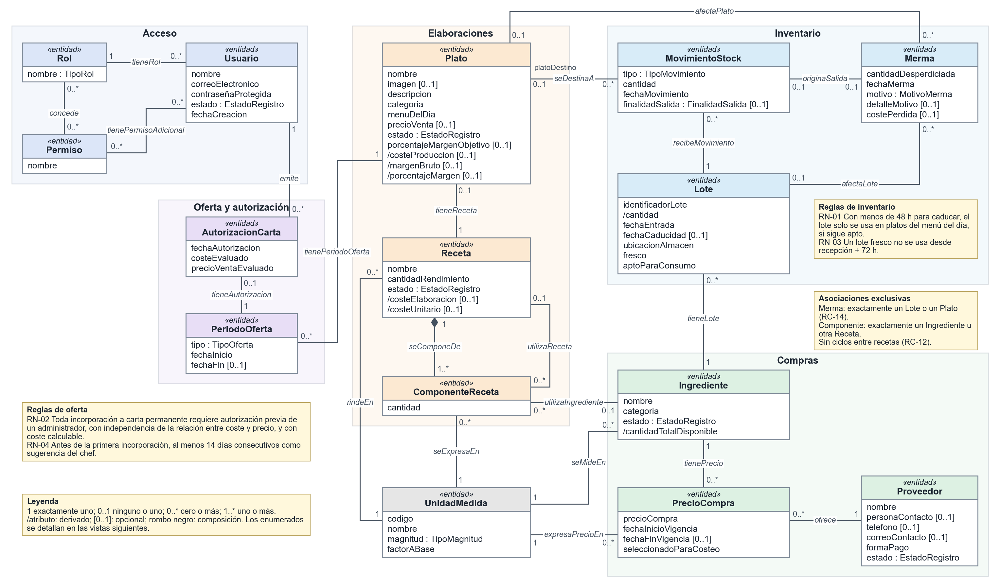

## 4.2. Usuarios, roles y permisos

Cada usuario tiene un rol. Sus permisos efectivos combinan los del rol con los permisos adicionales concedidos individualmente (D-03, RC-10). Por ejemplo, Luis, encargado, conserva los permisos de su rol y puede recibir el permiso de consultar la información económica sin cambiar de perfil.

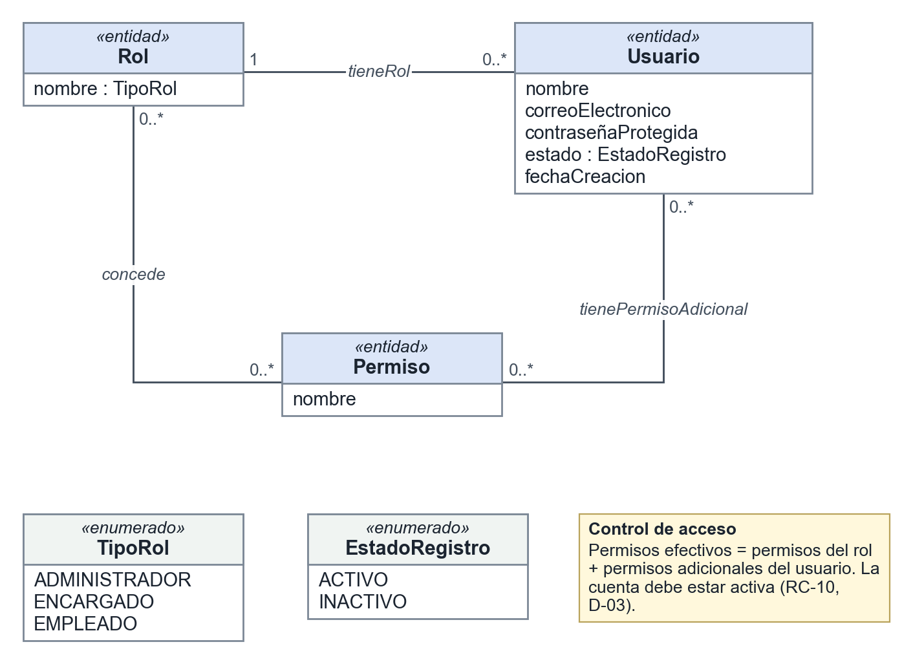

## 4.3. Proveedores, ingredientes y precios

PrecioCompra conserva el histórico de precios de cada proveedor e ingrediente. Se selecciona manualmente, como máximo, un precio por ingrediente para calcular costes, que debe estar vigente en el momento del cálculo (D-01). Si no hay uno válido seleccionado, el coste queda desconocido (RC-11).

UnidadMedida define las unidades admitidas, su magnitud y su factor de conversión a la unidad base de esa magnitud, lo que permite combinar, por ejemplo, gramos en una receta con un precio por kilogramo, y rechazar la conversión entre kilogramos y litros (RC-15).

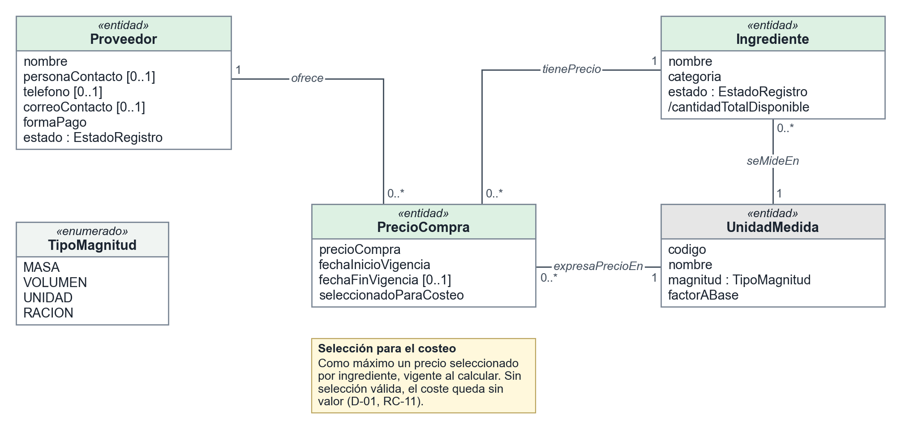

## 4.4. Platos y recetas

Cada plato tiene exactamente una receta. Una receta puede no pertenecer a ningún plato y actúa como subreceta cuando otra receta la utiliza como componente (D-07). Cada componente utiliza un ingrediente o una receta, con su cantidad y unidad. El rendimiento indica cuánto produce una receta y permite calcular el coste de la cantidad utilizada (D-02, RC-05). Las dependencias no pueden formar ciclos (RC-12).

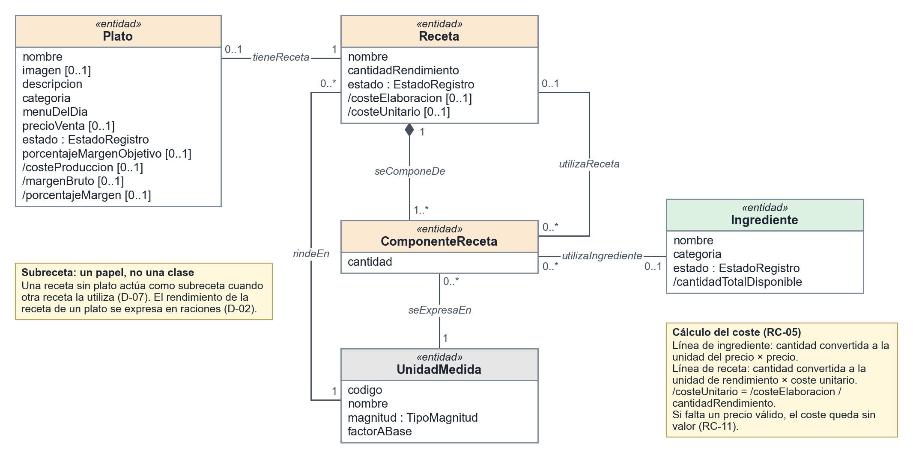

## 4.5. Lotes, movimientos y mermas

Los movimientos de entrada, salida y ajuste determinan el saldo de cada lote, que no puede ser negativo en ningún instante (RC-13). Las salidas distinguen elaboración, merma u otra finalidad (RC-17). Una merma afecta a un lote o a un plato y su coste es opcional cuando no se conoce (RC-14). Se admiten movimientos con fecha pasada si no producen saldos negativos en ningún momento afectado (RF-09).

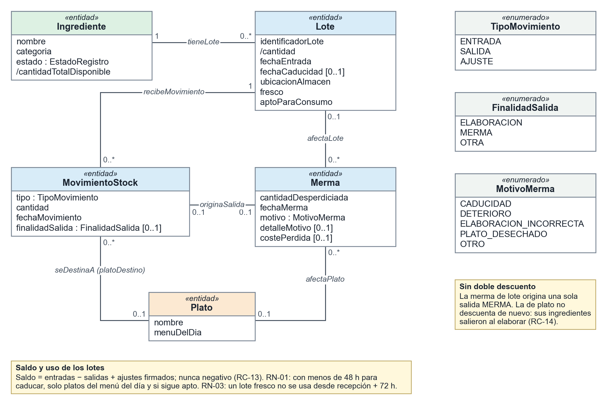

## 4.6. Oferta de platos y autorizaciones

Los periodos registran la oferta como sugerencia del chef o como carta permanente, y no pueden solaparse en un mismo plato (RC-16). Toda incorporación a la carta requiere una autorización previa, con independencia de su rentabilidad (RN-02). La autorización conserva el administrador, la fecha y los importes evaluados. Para un plato de nueva creación también se exige la prueba previa de 14 días consecutivos (RN-04).

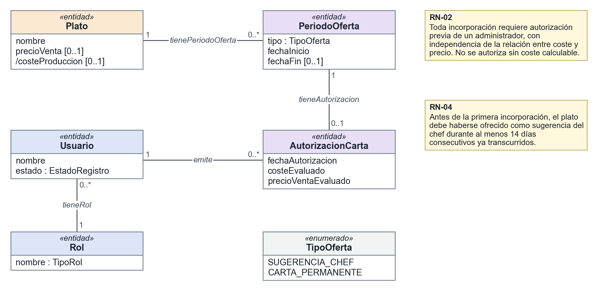

## 4.7. Escenarios de prueba

Los escenarios muestran objetos concretos del modelo. Las cabeceras subrayadas identifican objetos y sus atributos contienen valores de ejemplo. La expresión «unidad → kg» abrevia el enlace con el objeto UnidadMedida correspondiente. Los importes están en euros y las fechas son locales del restaurante.

| Escenario | Objetivo | Reglas principales | Resultado esperado |
|---|---|---|---|
| 1. Precio seleccionado | Elegir un precio entre dos proveedores | D-01, RC-03, RC-04, RC-11 | Válido; referencia de 1,20 €/kg |
| 2. Coste con subreceta | Aplicar cantidades y rendimiento al escandallo | D-02, D-07, RC-01, RC-02, RC-05, RC-07, RC-11, RC-12 | Válido; coste del plato de 0,60 € |
| 3. Merma de lote | Registrar una pérdida y descontar el stock una sola vez | RC-09, RC-13, RC-14, RC-17 | Válido; saldo de 8 kg y pérdida de 4 € |
| 4. Límite de frescura | Rechazar una elaboración al cumplir 72 horas | RN-03, D-04 | Rechazado; saldo sin cambios |
| 5. Incorporación a carta | Comprobar prueba previa y autorización | RN-02, RN-04, D-05, RC-09 | Válido; incorporación autorizada |

Estos cinco escenarios se reproducen como casos de prueba en el script de pruebas del modelo tecnológico, con los mismos datos y resultados.

### 4.7.1. Precio de referencia de un ingrediente

El 29 de octubre de 2026, la harina tiene dos precios vigentes: 1,20 €/kg de Distribuciones Norte y 1,40 €/kg de Suministros Sur. Solo el primero está seleccionado para calcular costes. Por tanto, utilizar 0,5 kg de harina cuesta 0,60 €; el precio del otro proveedor se conserva para consulta. La selección es explícita: que coincida con el más barato es circunstancial.

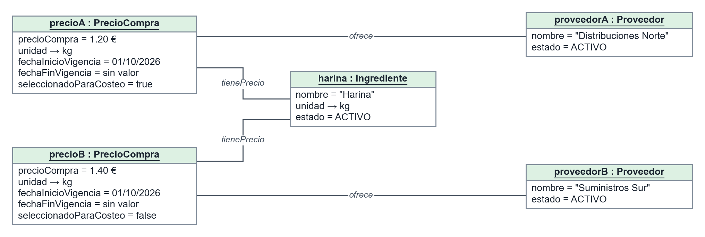

**Resultado: válido.** Los importes son positivos (RC-03), no hay vigencias solapadas para un mismo par proveedor-ingrediente (RC-04) y hay un único precio seleccionado (D-01).

### 4.7.2. Coste de un plato con una subreceta

Una elaboración de la receta de la salsa utiliza 2 kg de tomate a 3 €/kg y produce 1,5 kg. Su coste de elaboración es 6 € y su coste unitario, 4 €/kg. La receta de la degustación rinde una ración y utiliza 0,15 kg de salsa, que cuestan 0,60 €. Al venderse por 3 €, deja un margen bruto de 2,40 €, equivalente al 80 % del precio de venta. La receta de la salsa actúa aquí como subreceta: es una Receta más, utilizada como componente de otra.

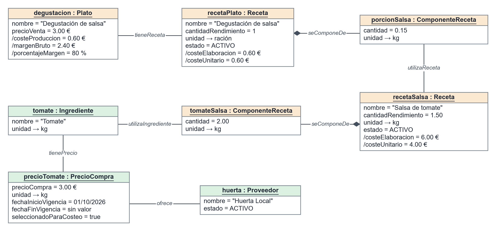

**Resultado: válido.** Las cantidades y el rendimiento son positivos (RC-01), no hay líneas repetidas (RC-02), la cadena termina en un ingrediente (RC-12) y todas las dependencias tienen un precio válido (RC-11). Este escenario comprueba el escandallo; no registra una elaboración real ni movimientos de almacén.

### 4.7.3. Merma y saldo del lote

El lote ARR-001 recibe 10 kg de arroz el 28 de octubre de 2026. Al día siguiente se derraman 2 kg. La merma genera una única salida y deja un saldo de 8 kg. La valoración aplicable es de 2 €/kg, de modo que se registra una pérdida de 4 €, que no se recalcula por cambios futuros de precios.

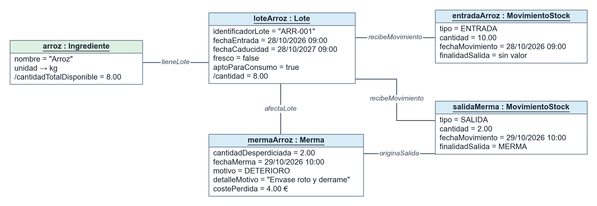

**Resultado: válido.** Se descuenta una sola salida (RC-14). Restar además la cantidad de la merma produciría un saldo incorrecto de 6 kg.

### 4.7.4. Rechazo de un lote fresco

Un lote fresco de lechuga entra el 26 de octubre de 2026 a las 10:00. El día 29 a esa misma hora se intenta utilizar 0,20 kg para una ensalada. Aunque sigue apto, no ha caducado y el plato pertenece al menú del día, la operación se rechaza porque han transcurrido 72 horas. No se registra la salida y el saldo permanece en 3 kg. Los elementos rojos discontinuos representan el intento rechazado, no información almacenada.

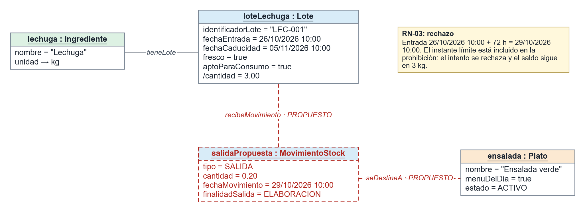

**Resultado: rechazado por RN-03.** El rechazo no crea automáticamente una merma; cualquier pérdida posterior debe registrarse por separado.

### 4.7.5. Incorporación autorizada a la carta

La lasaña completa 14 días de prueba, del 1 al 15 de octubre de 2026 a las 12:00. Su coste calculado es 4 € y su precio de venta, 10 €. Ana, administradora, autoriza la incorporación a las 11:00 del día 15 y a las 12:00 comienza el periodo de carta permanente. La aprobación es obligatoria para toda incorporación; no depende de la proporción entre coste y precio.

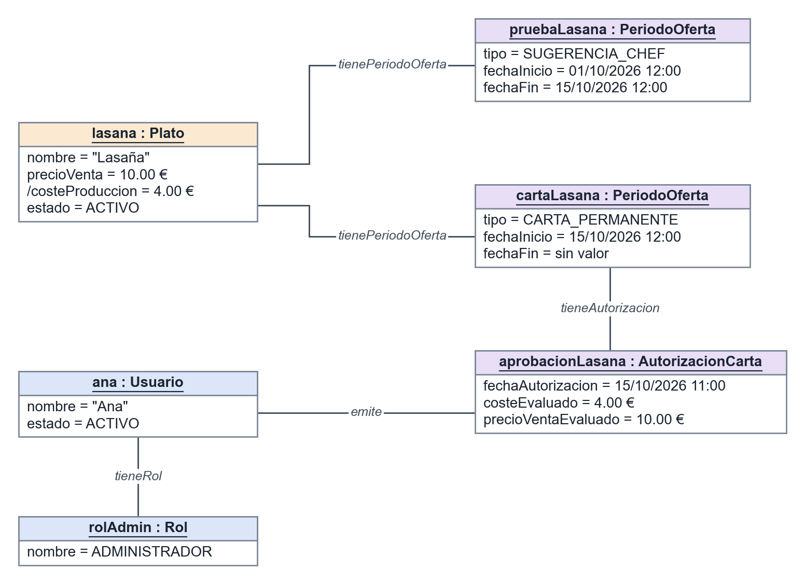

**Resultado: válido.** La prueba dura 14 días consecutivos ya transcurridos (RN-04), la autorización es previa y su emisora tiene rol de administrador (RN-02), y el coste y el precio quedan registrados como dato histórico (RC-09).
