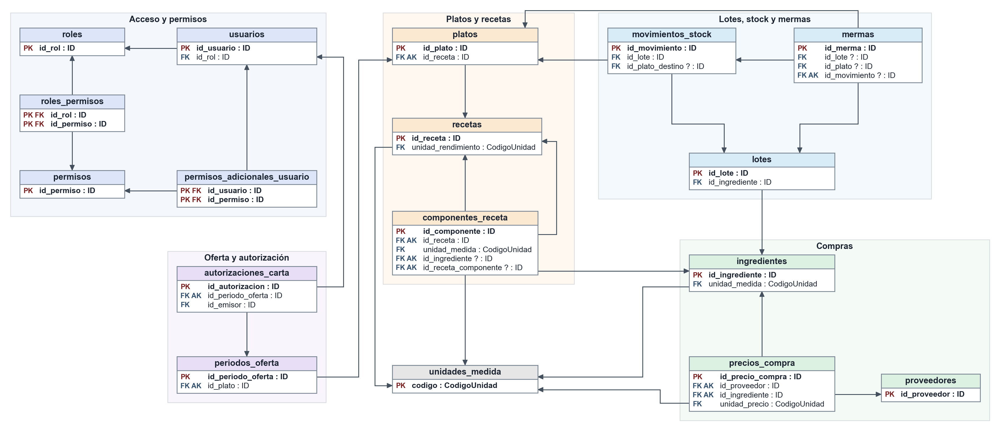
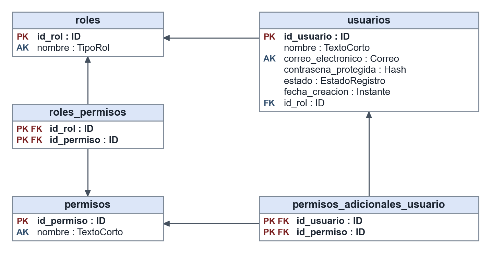
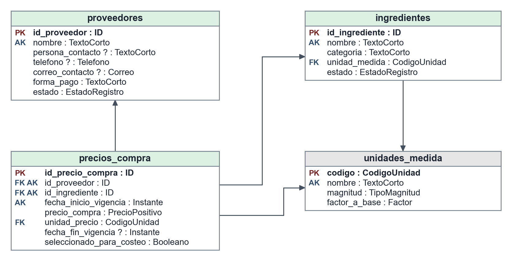
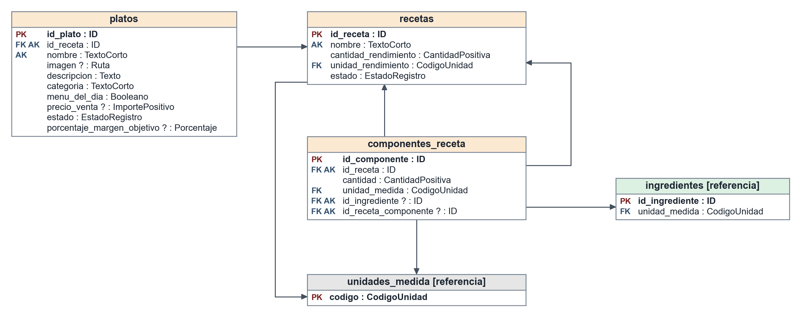
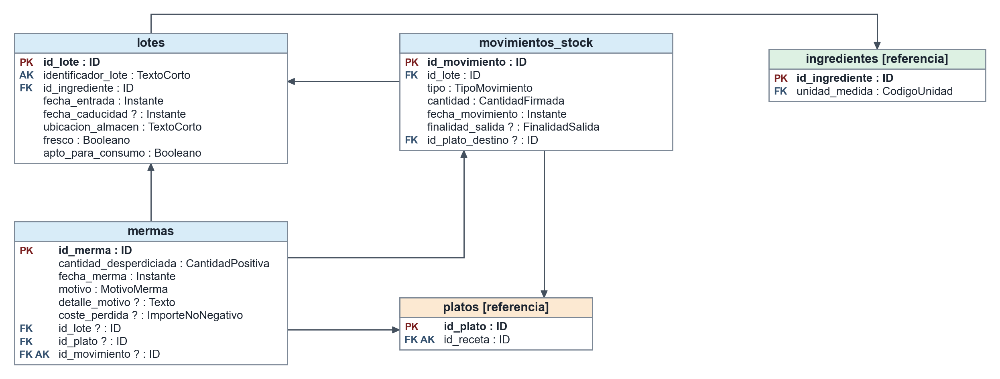
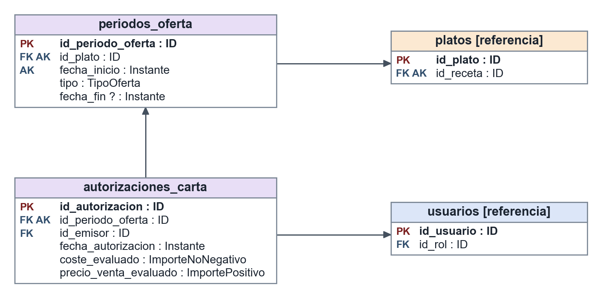

# 5. Modelo relacional en 3FN

Esta sección obtiene el modelo relacional a partir del modelo conceptual de la sección 4 y justifica que todas sus relaciones están en tercera forma normal. Las reglas se citan con los identificadores del catálogo de requisitos (RN, RC y D).

**Notación.** `relacion(pk, atributo, atributo?, #fk)`: el primer atributo es la clave primaria, `#` indica clave ajena y `?` indica que el atributo admite nulos. En las dos relaciones procedentes de asociaciones N:M, la clave primaria está formada por todos sus atributos. AK designa una clave alternativa. Los nombres coinciden con los que se utilizan en el código SQL.

## 5.1. Relaciones obtenidas

### 5.1.1. Proceso de transformación

La transformación se aplica en siete pasos:

1. **Entidades.** Cada entidad da lugar a una relación con clave primaria subrogada (`id_*`), salvo `unidades_medida`, cuyo código es una clave natural breve y estable.
2. **Atributos.** Los atributos simples pasan a columnas. Los derivados no se almacenan (sección 5.3.3). Los enumerados pasan a dominios cerrados.
3. **Asociaciones 1:N.** La clave primaria del extremo 1 se añade como clave ajena en el extremo N. Si el mínimo es 0, la clave ajena admite nulos.
4. **Asociaciones 1:1.** La clave ajena se sitúa en el extremo cuya participación es obligatoria y se declara única.
5. **Asociaciones N:M.** Generan una relación propia cuya clave primaria es la combinación de ambas claves ajenas.
6. **Asociación recursiva.** `utilizaReceta` se transforma en una segunda clave ajena de `componentes_receta` hacia `recetas`.
7. **Asociaciones exclusivas.** Cada alternativa se transforma en una clave ajena que admite nulos, y una restricción CHECK exige que se informe exactamente una.

La Tabla 5.1 recoge la correspondencia de las entidades y la Tabla 5.2, la de las asociaciones.

**Tabla 5.1. Correspondencia de entidades del MC con relaciones del MR.**

| Entidad (MC) | Relación (MR) | Observaciones |
|---|---|---|
| Rol | `roles` | `nombre` es clave alternativa. |
| Permiso | `permisos` | `nombre` es clave alternativa. |
| Usuario | `usuarios` | `contraseñaProtegida` pasa a `contrasena_protegida`. |
| Proveedor | `proveedores` | Contacto en atributos atómicos (S-06). |
| UnidadMedida | `unidades_medida` | Clave primaria natural `codigo`. |
| Ingrediente | `ingredientes` | `/cantidadTotalDisponible` no se almacena. |
| PrecioCompra | `precios_compra` | Histórico por vigencias. |
| Plato | `platos` | `/costeProduccion`, `/margenBruto` y `/porcentajeMargen` no se almacenan. |
| Receta | `recetas` | `/costeElaboracion` y `/costeUnitario` no se almacenan. |
| ComponenteReceta | `componentes_receta` | Componente exclusivo. |
| Lote | `lotes` | `/cantidad` no se almacena. |
| MovimientoStock | `movimientos_stock` | Origen del saldo de cada lote. |
| Merma | `mermas` | Elemento afectado exclusivo. |
| PeriodoOferta | `periodos_oferta` | |
| AutorizacionCarta | `autorizaciones_carta` | |

**Tabla 5.2. Correspondencia de asociaciones del MC con elementos del MR.**

| Asociación (MC) | Multiplicidad | Elemento en el MR |
|---|---|---|
| tieneRol | Rol 1 — 0..\* Usuario | `usuarios.id_rol` |
| concede | Rol 0..\* — 0..\* Permiso | Relación `roles_permisos` |
| tienePermisoAdicional | Usuario 0..\* — 0..\* Permiso | Relación `permisos_adicionales_usuario` |
| emite | Usuario 1 — 0..\* AutorizacionCarta | `autorizaciones_carta.id_emisor` |
| ofrece | Proveedor 1 — 0..\* PrecioCompra | `precios_compra.id_proveedor` |
| tienePrecio | Ingrediente 1 — 0..\* PrecioCompra | `precios_compra.id_ingrediente` |
| seMideEn | UnidadMedida 1 — 0..\* Ingrediente | `ingredientes.unidad_medida` |
| expresaPrecioEn | UnidadMedida 1 — 0..\* PrecioCompra | `precios_compra.unidad_precio` |
| rindeEn | UnidadMedida 1 — 0..\* Receta | `recetas.unidad_rendimiento` |
| seExpresaEn | UnidadMedida 1 — 0..\* ComponenteReceta | `componentes_receta.unidad_medida` |
| tieneReceta | Plato 0..1 — 1 Receta | `platos.id_receta`, NOT NULL y única |
| seComponeDe | Receta 1 — 1..\* ComponenteReceta | `componentes_receta.id_receta` |
| utilizaIngrediente | ComponenteReceta 0..\* — 0..1 Ingrediente | `componentes_receta.id_ingrediente`, admite nulos |
| utilizaReceta | ComponenteReceta 0..\* — 0..1 Receta | `componentes_receta.id_receta_componente`, admite nulos |
| tieneLote | Ingrediente 1 — 0..\* Lote | `lotes.id_ingrediente` |
| recibeMovimiento | Lote 1 — 0..\* MovimientoStock | `movimientos_stock.id_lote` |
| seDestinaA | MovimientoStock 0..\* — 0..1 Plato | `movimientos_stock.id_plato_destino`, admite nulos |
| afectaLote | Merma 0..\* — 0..1 Lote | `mermas.id_lote`, admite nulos |
| afectaPlato | Merma 0..\* — 0..1 Plato | `mermas.id_plato`, admite nulos |
| originaSalida | Merma 0..1 — 0..1 MovimientoStock | `mermas.id_movimiento`, admite nulos y es única |
| tienePeriodoOferta | Plato 1 — 0..\* PeriodoOferta | `periodos_oferta.id_plato` |
| tieneAutorizacion | PeriodoOferta 1 — 0..1 AutorizacionCarta | `autorizaciones_carta.id_periodo_oferta`, NOT NULL y única |

### 5.1.2. Esquema relacional resultante

El modelo consta de 17 relaciones: 15 procedentes de entidades y 2 de asociaciones N:M.

**Acceso y permisos**

- `roles(id_rol, nombre)`; AK: `nombre`.
- `permisos(id_permiso, nombre)`; AK: `nombre`.
- `usuarios(id_usuario, nombre, correo_electronico, contrasena_protegida, estado, fecha_creacion, #id_rol)`; AK: `correo_electronico`.
- `roles_permisos(#id_rol, #id_permiso)`.
- `permisos_adicionales_usuario(#id_usuario, #id_permiso)`.

**Compras y precios**

- `unidades_medida(codigo, nombre, magnitud, factor_a_base)`; AK: `nombre`.
- `proveedores(id_proveedor, nombre, persona_contacto?, telefono?, correo_contacto?, forma_pago, estado)`; AK: `nombre`.
- `ingredientes(id_ingrediente, nombre, categoria, #unidad_medida, estado)`; AK: `nombre`.
- `precios_compra(id_precio_compra, #id_proveedor, #id_ingrediente, precio_compra, #unidad_precio, fecha_inicio_vigencia, fecha_fin_vigencia?, seleccionado_para_costeo)`; AK: `(id_proveedor, id_ingrediente, fecha_inicio_vigencia)`.

**Platos y recetas**

- `recetas(id_receta, nombre, cantidad_rendimiento, #unidad_rendimiento, estado)`; AK: `nombre`.
- `platos(id_plato, #id_receta, nombre, imagen?, descripcion, categoria, menu_del_dia, precio_venta?, estado, porcentaje_margen_objetivo?)`; AK: `id_receta`; AK: `nombre`.
- `componentes_receta(id_componente, #id_receta, cantidad, #unidad_medida, #id_ingrediente?, #id_receta_componente?)`; únicas: `(id_receta, id_ingrediente)` y `(id_receta, id_receta_componente)`.

**Lotes, stock y mermas**

- `lotes(id_lote, identificador_lote, #id_ingrediente, fecha_entrada, fecha_caducidad?, ubicacion_almacen, fresco, apto_para_consumo)`; AK: `identificador_lote`.
- `movimientos_stock(id_movimiento, #id_lote, tipo, cantidad, fecha_movimiento, finalidad_salida?, #id_plato_destino?)`.
- `mermas(id_merma, cantidad_desperdiciada, fecha_merma, motivo, detalle_motivo?, coste_perdida?, #id_lote?, #id_plato?, #id_movimiento?)`; única: `id_movimiento`.

**Oferta y autorización**

- `periodos_oferta(id_periodo_oferta, #id_plato, tipo, fecha_inicio, fecha_fin?)`; AK: `(id_plato, fecha_inicio)`.
- `autorizaciones_carta(id_autorizacion, #id_periodo_oferta, #id_emisor, fecha_autorizacion, coste_evaluado, precio_venta_evaluado)`; AK: `id_periodo_oferta`.

Las vistas siguientes detallan los atributos y dominios de cada grupo. Una tabla marcada como [referencia] solo se muestra para situar una clave ajena.

### 5.1.3. Dominios

**Tabla 5.3. Dominios del modelo relacional.**

| Dominio | Definición |
|---|---|
| ID | Entero positivo generado por el sistema. |
| CodigoUnidad | Texto de hasta 10 caracteres. |
| TextoCorto | Texto de hasta 100 caracteres. |
| Texto | Texto de hasta 500 caracteres. |
| Ruta | Texto de hasta 255 caracteres. |
| Correo | Texto de hasta 150 caracteres que contiene una arroba. |
| Telefono | Texto de hasta 20 caracteres. |
| Hash | Texto de al menos 60 caracteres (RNF-02). |
| Instante | Fecha y hora local del restaurante. |
| Booleano | Verdadero o falso. |
| CantidadPositiva | Decimal mayor que cero, con cuatro decimales. |
| CantidadFirmada | Decimal distinto de cero, con cuatro decimales. |
| PrecioPositivo | Decimal mayor que cero, con cuatro decimales. |
| ImportePositivo | Decimal mayor que cero, con dos decimales. |
| ImporteNoNegativo | Decimal mayor o igual que cero, con dos decimales. |
| Porcentaje | Decimal en el intervalo [0, 100). |
| Factor | Decimal mayor que cero, con seis decimales. |
| TipoRol | ADMINISTRADOR, ENCARGADO, EMPLEADO. |
| EstadoRegistro | ACTIVO, INACTIVO. |
| TipoMagnitud | MASA, VOLUMEN, UNIDAD, RACION. |
| TipoMovimiento | ENTRADA, SALIDA, AJUSTE. |
| FinalidadSalida | ELABORACION, MERMA, OTRA. |
| MotivoMerma | CADUCIDAD, DETERIORO, ELABORACION_INCORRECTA, PLATO_DESECHADO, OTRO. |
| TipoOferta | SUGERENCIA_CHEF, CARTA_PERMANENTE. |

### 5.1.4. Integridad referencial

La política general es impedir el borrado de filas referenciadas (ON DELETE RESTRICT), porque RC-09 exige conservar el histórico y las entidades maestras se desactivan mediante su atributo `estado`. Las claves subrogadas no cambian, por lo que también se usa ON UPDATE RESTRICT. Las excepciones se recogen en la Tabla 5.4.

**Tabla 5.4. Excepciones a la política referencial general.**

| Clave ajena | Acción | Justificación |
|---|---|---|
| `roles_permisos.id_rol`, `roles_permisos.id_permiso` | ON DELETE CASCADE | Una concesión no tiene existencia sin su rol y su permiso, y no es información histórica. |
| `permisos_adicionales_usuario.id_usuario`, `.id_permiso` | ON DELETE CASCADE | Mismo motivo que en la fila anterior. |
| `componentes_receta.id_receta` | ON DELETE CASCADE | La línea forma parte de la receta por composición. |
| Claves ajenas hacia `unidades_medida.codigo` | ON UPDATE CASCADE | Es una clave natural: corregir un código no debe obligar a reescribir sus usos. El borrado sigue restringido. |

### 5.1.5. Catálogo de restricciones

La Tabla 5.5 sustituye a las referencias R-01 a R-15 del borrador del modelo relacional, que remitían a un documento inexistente. Indica cómo se garantiza cada regla: de forma declarativa cuando es posible y mediante triggers o procedimientos cuando MariaDB no lo permite.

**Tabla 5.5. Reglas y mecanismo que las garantiza.**

| Regla | Relación | Mecanismo |
|---|---|---|
| RC-01 | `componentes_receta`, `recetas` | CHECK de cantidad y rendimiento positivos. |
| RC-02 | `componentes_receta` | UNIQUE `(id_receta, id_ingrediente)` y `(id_receta, id_receta_componente)`. |
| RC-03 | `precios_compra` | CHECK de precio positivo. |
| RC-04 | `precios_compra` | AK, CHECK de fin posterior al inicio y trigger de no solapamiento. |
| D-01 | `precios_compra` | Índice único sobre una columna virtual que solo toma valor si el precio está seleccionado. |
| RC-05, RC-11 | Funciones de coste | Cálculo recursivo; devuelve nulo si falta un precio válido. |
| RC-06, RC-07 | Funciones y vistas | Se cumplen por construcción, porque el coste y el margen no se almacenan. |
| RC-08, D-06 | `platos` | Atributo opcional con CHECK de porcentaje. |
| RC-09 | Todas | Claves ajenas restrictivas, desactivación lógica y triggers que impiden modificar o borrar movimientos y mermas. |
| RC-10, D-03, RNF-01 | Procedimientos | Función de permisos efectivos, comprobada en cada procedimiento que recibe el usuario. |
| RC-12 | `componentes_receta` | CHECK contra la autorreferencia directa y trigger con consulta recursiva. |
| RC-13 | `movimientos_stock` | Trigger que comprueba el saldo en el instante afectado y en los posteriores. |
| RC-14 | `mermas` | CHECK de exclusividad y de correspondencia entre lote y movimiento, UNIQUE y trigger que genera la salida. |
| RC-15, D-02 | `precios_compra`, `componentes_receta`, `platos` | Triggers que comparan magnitudes y exigen raciones en la receta de un plato. |
| RC-16 | `periodos_oferta` | AK, CHECK de fin posterior al inicio y trigger de no solapamiento. |
| RC-17 | `movimientos_stock` | CHECK compuesto de coherencia y trigger sobre la fecha de entrada del lote. |
| RN-01 | `movimientos_stock` | Trigger sobre las salidas de elaboración. |
| RN-02 | `autorizaciones_carta`, `periodos_oferta` | Trigger de validación y procedimiento atómico de incorporación. |
| RN-03, D-04 | `movimientos_stock` | Trigger sobre las salidas de elaboración de lotes frescos. |
| RN-04, D-05 | `periodos_oferta` | Trigger sobre el inicio de una carta permanente. |
| RNF-02 | `usuarios` | CHECK de longitud mínima del hash. |

Dos multiplicidades mínimas no pueden expresarse de forma declarativa porque MariaDB no dispone de restricciones diferidas: `Receta 1..* ComponenteReceta` y la autorización obligatoria de un periodo de carta permanente. Se garantizan con procedimientos atómicos y se verifican con un procedimiento de auditoría; además, una receta sin componentes no tiene coste calculable (RC-11).

## 5.2. Estrategia de transformación de jerarquías

**El modelo conceptual no contiene jerarquías de generalización**, por lo que no se aplica ninguna estrategia de transformación. No obstante, se analizaron los cuatro conceptos que podrían haberse modelado como especialización:

| Concepto | Por qué no es una jerarquía |
|---|---|
| Subreceta | Es un papel de Receta, no un subtipo: no tiene atributos propios y una receta puede ser a la vez la de un plato y componente de otra (D-07). La segunda entrega la modelaba como clase propia; el Anexo A justifica el cambio. |
| Merma de lote y merma de plato | Comparten todos sus atributos y solo difieren en el elemento afectado. |
| Tipos de movimiento | Comparten todos sus atributos; la finalidad y el plato de destino son opcionales y dependen de reglas de coherencia (RC-17). |
| Tipos de rol | Se distinguen por los permisos que conceden, que son datos, no por su estructura. |

El caso de `Merma` es el más próximo a una jerarquía total y disjunta, de modo que conviene justificar su transformación. Se valoraron las tres estrategias habituales:

| Estrategia | Consecuencia | Decisión |
|---|---|---|
| Una relación para cada subtipo | Las consultas de pérdidas totales requerirían UNION y los atributos comunes se duplicarían en el esquema. | Descartada |
| Una relación para el supertipo y otra para cada subtipo | Exigiría dos relaciones con un único atributo cada una, y un JOIN adicional por consulta. | Descartada |
| Una sola relación con claves ajenas exclusivas | Los atributos comunes se definen una vez; solo requiere dos claves ajenas que admiten nulos y un CHECK. | **Adoptada** |

La estrategia adoptada también se aplica a `componentes_receta`. Un CHECK garantiza la exclusividad y mantiene la integridad referencial de cada alternativa, que no sería posible con una única clave ajena polimórfica.

## 5.3. Justificación de la 3FN

### 5.3.1. Criterio

Una relación está en **1FN** si todos sus atributos son atómicos; en **2FN** si, además, ningún atributo no primo depende de una parte propia de una clave candidata; y en **3FN** si, además, ningún atributo no primo depende transitivamente de una clave candidata a través de otro atributo no primo.

**1FN.** Todos los dominios son atómicos. El atributo compuesto `informacionContacto` de la segunda entrega se ha descompuesto en `persona_contacto`, `telefono` y `correo_contacto`, y el `motivo` en texto libre, en una categoría cerrada y un detalle opcional (S-06).

Las restricciones condicionales (por ejemplo, que una salida de elaboración tenga plato de destino) no son dependencias funcionales: las filas con nulo en el determinante no determinan un único valor. Por eso se expresan con CHECK y no afectan a la normalización.

### 5.3.2. Análisis por relación

Para cada relación se indican sus claves candidatas (CC) y dependencias funcionales (DF) no triviales. Se omiten, por simplicidad, las DF que parten de una clave alternativa hacia los mismos atributos.

**`roles`.** CC: `id_rol`, `nombre`. DF: `id_rol → nombre`. Claves simples y sin más atributos: no puede haber dependencias parciales ni transitivas.

**`permisos`.** CC: `id_permiso`, `nombre`. DF: `id_permiso → nombre`. El mismo razonamiento que en `roles`.

**`usuarios`.** CC: `id_usuario`, `correo_electronico`. DF: `id_usuario → nombre, correo_electronico, contrasena_protegida, estado, fecha_creacion, id_rol`. Claves simples: no hay dependencias parciales. No hay transitivas: `id_rol` no determina ningún atributo de esta relación, porque los permisos del rol están en `roles_permisos`, y el nombre puede repetirse.

**`roles_permisos`.** CC: `(id_rol, id_permiso)`. DF: solo triviales. Todos los atributos son primos: cumple la 3FN de forma inmediata.

**`permisos_adicionales_usuario`.** CC: `(id_usuario, id_permiso)`. DF: solo triviales. Todos los atributos son primos.

**`unidades_medida`.** CC: `codigo`, `nombre`. DF: `codigo → nombre, magnitud, factor_a_base`. Claves simples: no hay parciales. No hay transitivas: `magnitud` no determina `factor_a_base`, porque varias unidades de una misma magnitud tienen factores distintos.

**`proveedores`.** CC: `id_proveedor`, `nombre`. DF: `id_proveedor → nombre, persona_contacto, telefono, correo_contacto, forma_pago, estado`. Claves simples: no hay parciales. No hay transitivas: los datos de contacto describen el punto de contacto de cada proveedor. Una misma persona o teléfono puede figurar en varios proveedores con otros datos, y la persona no se gestiona como entidad, de modo que `persona_contacto` no determina `telefono`.

**`ingredientes`.** CC: `id_ingrediente`, `nombre`. DF: `id_ingrediente → nombre, categoria, unidad_medida, estado`. Claves simples: no hay parciales. No hay transitivas: `categoria` no determina `unidad_medida`, porque dentro de una categoría unos ingredientes se miden en kilogramos y otros en unidades.

**`precios_compra`.** CC: `id_precio_compra` y `(id_proveedor, id_ingrediente, fecha_inicio_vigencia)`. DF: `id_precio_compra → id_proveedor, id_ingrediente, precio_compra, unidad_precio, fecha_inicio_vigencia, fecha_fin_vigencia, seleccionado_para_costeo`. No hay parciales respecto a la clave compuesta: un mismo proveedor e ingrediente tienen varios precios a lo largo del tiempo, y `id_ingrediente` no determina `unidad_precio` porque cada proveedor puede vender en una unidad distinta. No hay transitivas.

**`recetas`.** CC: `id_receta`, `nombre`. DF: `id_receta → nombre, cantidad_rendimiento, unidad_rendimiento, estado`. Claves simples: no hay parciales. No hay transitivas: rendimiento, unidad y estado son independientes entre sí.

**`platos`.** CC: `id_plato`, `id_receta`, `nombre`. DF: `id_plato → id_receta, nombre, imagen, descripcion, categoria, menu_del_dia, precio_venta, estado, porcentaje_margen_objetivo`. Claves simples: no hay parciales. `id_receta` es clave candidata (cada plato tiene una receta y cada receta, como máximo un plato), por lo que los atributos que determina no constituyen una dependencia transitiva. `categoria` no determina `precio_venta` ni `menu_del_dia`.

**`componentes_receta`.** CC: `id_componente`; además, `(id_receta, id_ingrediente)` y `(id_receta, id_receta_componente)` identifican la línea cuando su componente está informado. DF: `id_componente → id_receta, cantidad, unidad_medida, id_ingrediente, id_receta_componente`. No hay parciales: la cantidad y la unidad dependen de la línea completa, ya que un mismo ingrediente se usa en distintas cantidades y unidades según la receta. No hay transitivas.

**`lotes`.** CC: `id_lote`, `identificador_lote`. DF: `id_lote → identificador_lote, id_ingrediente, fecha_entrada, fecha_caducidad, ubicacion_almacen, fresco, apto_para_consumo`. Claves simples: no hay parciales. No hay transitivas: `id_ingrediente` no determina `fresco` porque la frescura se clasifica por lote (D-04), ni `fecha_caducidad`, que depende de cada entrada.

**`movimientos_stock`.** CC: `id_movimiento`. DF: `id_movimiento → id_lote, tipo, cantidad, fecha_movimiento, finalidad_salida, id_plato_destino`. Clave simple: no hay parciales. No hay transitivas: `finalidad_salida` y `id_plato_destino` están ligados por una restricción condicional, no por una DF, pues todas las filas sin plato de destino tienen nulo en el determinante y distintas finalidades.

**`mermas`.** CC: `id_merma`; además, `id_movimiento` identifica la fila cuando está informado. DF: `id_merma → cantidad_desperdiciada, fecha_merma, motivo, detalle_motivo, coste_perdida, id_lote, id_plato, id_movimiento`. Clave simple: no hay parciales. Tampoco hay transitivas: los atributos que determina `id_movimiento` no suponen una violación porque este es una clave. `detalle_motivo` no determina `motivo`. La redundancia con `movimientos_stock`, que no es una violación de la 3FN, se trata en la sección 5.3.4.

**`periodos_oferta`.** CC: `id_periodo_oferta` y `(id_plato, fecha_inicio)`. DF: `id_periodo_oferta → id_plato, tipo, fecha_inicio, fecha_fin`. No hay parciales: `id_plato` por sí solo no determina `tipo` ni `fecha_fin`, ya que un plato tiene varios periodos. No hay transitivas.

**`autorizaciones_carta`.** CC: `id_autorizacion`, `id_periodo_oferta`. DF: `id_autorizacion → id_periodo_oferta, id_emisor, fecha_autorizacion, coste_evaluado, precio_venta_evaluado`. Claves simples: no hay parciales. No hay transitivas: `id_emisor` no determina la fecha ni los importes.

**Conclusión.** Las 17 relaciones cumplen 1FN, 2FN y 3FN. Como en todas ellas los únicos determinantes son claves candidatas, o claves alternativas que admiten nulos e identifican la fila cuando están informadas, también cumplen la forma normal de Boyce-Codd.

### 5.3.3. Atributos derivados

Ningún atributo derivado del modelo conceptual se almacena. Se calculan cuando se consultan, de modo que no pueden quedar desactualizados y RC-06 se cumple sin mantenimiento adicional.

**Tabla 5.6. Cálculo de los atributos derivados.**

| Atributo (MC) | Cálculo | Elemento SQL |
|---|---|---|
| Lote `/cantidad` | Entradas − salidas + ajustes firmados | `fn_saldo_lote` |
| Ingrediente `/cantidadTotalDisponible` | Suma de los saldos de sus lotes | `fn_stock_ingrediente` |
| Receta `/costeElaboracion` | Suma de los costes de sus líneas, con recorrido recursivo | `fn_coste_elaboracion_receta` |
| Receta `/costeUnitario` | `/costeElaboracion` / `cantidad_rendimiento` | `fn_coste_unitario_receta` |
| Plato `/costeProduccion` | `/costeUnitario` de su receta | `fn_coste_produccion_plato` |
| Plato `/margenBruto` | `precio_venta` − `/costeProduccion` | `vw_escandallo_platos` |
| Plato `/porcentajeMargen` | 100 × `/margenBruto` / `precio_venta` | `vw_escandallo_platos` |

### 5.3.4. Decisiones que requieren justificación expresa

No se ha introducido ninguna desnormalización por rendimiento. Tres decisiones podrían interpretarse como tal y se justifican a continuación.

**Valores evaluados en el momento de un hecho.** `mermas.coste_perdida`, `autorizaciones_carta.coste_evaluado` y `autorizaciones_carta.precio_venta_evaluado` no son atributos derivados, sino hechos históricos: registran el valor que se aplicó en un instante. No pueden recalcularse después porque los precios, la selección de precios y las recetas cambian, y RC-09 obliga a conservarlos. Por tanto, no existe ninguna dependencia funcional que los determine.

**Redundancia controlada entre `mermas` y `movimientos_stock`.** Una merma de lote repite el lote, la cantidad y la fecha de la salida que origina. Cada relación sigue en 3FN, pero la base de datos almacena el mismo hecho en dos lugares. Se mantiene por tres motivos:

- El modelo conceptual y el escenario 3 definen la merma con su propia cantidad y fecha.
- Las mermas de plato no tienen movimiento, de modo que esos atributos deben existir en `mermas`. Mantenerlos también en las de lote permite consultar todas las pérdidas sin distinguir casos.
- El riesgo de incoherencia está controlado: la salida la genera un trigger a partir de la propia merma (RC-14), y ni mermas ni movimientos pueden modificarse después (RC-09). La auditoría comprueba además que coinciden.

**Columna virtual de `precios_compra`.** Para garantizar D-01 de forma declarativa, la implementación añade una columna virtual que vale `id_ingrediente` si el precio está seleccionado, y nulo en caso contrario, con un índice único. No forma parte del modelo lógico ni se almacena: es el mecanismo con el que MariaDB emula un índice único parcial.
